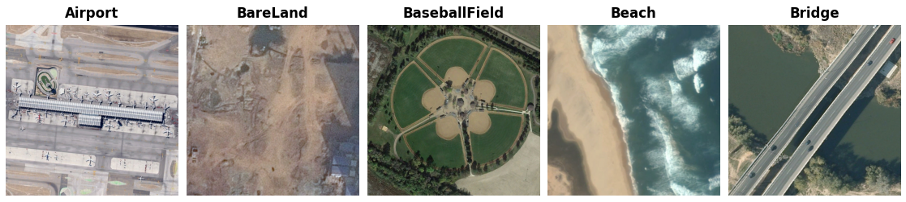

AID
===

.. raw:: html

   

   
   
   
   

Overview
--------
AID (Aerial Image Dataset) contains 10,000 Google Earth aerial images covering
30 scene categories. The collection includes different countries, seasons,
imaging conditions, and spatial resolutions. Every image is returned at its
native 600 x 600 pixel size, with RGB channels and no resizing or cropping.

- **Train**: 10,000 images (the entire collection)
- **Classes**: 30; 220-420 images per class
- **Validation / Test**: Not provided

.. important::

   ``train`` is a storage name for the full collection, not an official training
   partition. The original evaluation uses repeated random train/test
   partitions, not fixed published image lists. This reader does not create a
   holdout. Define and record any evaluation partition separately, before model
   selection, and do not evaluate on images used for training.

Data Structure
--------------

.. list-table::
   :header-rows: 1
   :widths: 20 20 60

   * - Key
     - Type
     - Description
   * - ``image``
     - ``PIL.Image.Image``
     - 600 x 600 RGB image
   * - ``label``
     - int
     - Scene label (0-29)

Class IDs follow the fixed alphabetical order of the original class-directory
names, from ``Airport`` to ``Viaduct``. The names retain their original casing.
Examples are ordered by archive path for reproducibility.

Usage Example
-------------

.. code-block:: python

    from stable_datasets.images.aid import AID

    # Downloads the raw archive and prepares the local Arrow cache.
    ds = AID(split="train")
    sample = ds[0]
    print(sample["image"].size)  # (600, 600)
    print(ds.features["label"].int2str(sample["label"]))  # Airport

    ds_all = AID()  # StableDatasetDict containing only "train"
    ds_torch = ds.with_format("torch")

Download and Provenance
-----------------------
The original project links to OneDrive and Baidu. For automatic downloads, this
reader uses the public ``shard_05/raw_dataset/AID.zip`` archive in the
`Vision-Flan repository <https://huggingface.co/datasets/Vision-Flan/vision-flan/tree/a7fc1f3307439d00e39acb9a944356b346531ae9/shard_05/raw_dataset>`_,
pinned to revision ``a7fc1f3307439d00e39acb9a944356b346531ae9``. This is a
third-party raw-data mirror, not a new AID release or the Vision-Flan instruction
task subset. The approximately 2.63 GB ZIP contains 10,000 JPEGs under
``AID/AID/<class>/<filename>.jpg``. No account is required for this mirror.

The mirror's archive listing and sampled native-resolution images were checked
against AID's published structure. Byte-for-byte identity with the original
OneDrive archive has not been established. Mirror availability does not grant
additional image-use rights; consult the original authors and imagery terms for
your intended use. No dataset license is inferred from a hosting service.

References
----------

- `Original AID project <https://captain-whu.github.io/AID/>`_
- `Original paper <https://doi.org/10.1109/TGRS.2017.2685945>`_
- `Pinned raw-data mirror <https://huggingface.co/datasets/Vision-Flan/vision-flan/blob/a7fc1f3307439d00e39acb9a944356b346531ae9/shard_05/raw_dataset/AID.zip>`_

Citation
--------

.. code-block:: bibtex

    @article{xia2017aid,
      title={AID: A Benchmark Data Set for Performance Evaluation of Aerial Scene Classification},
      author={Xia, Gui-Song and Hu, Jingwen and Hu, Fan and Shi, Baoguang and Bai, Xiang and Zhong, Yanfei and Zhang, Liangpei and Lu, Xiaoqiang},
      journal={IEEE Transactions on Geoscience and Remote Sensing},
      volume={55},
      number={7},
      pages={3965--3981},
      year={2017},
      doi={10.1109/TGRS.2017.2685945}
    }
