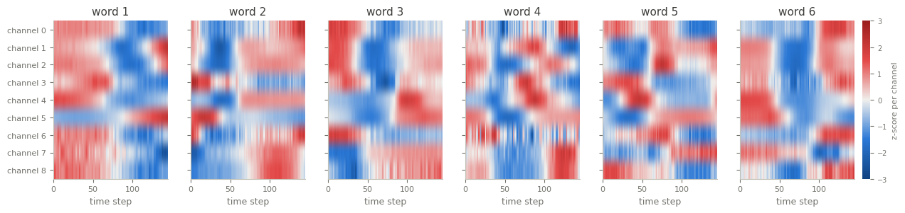

ArticularyWordRecognition
=========================

.. raw:: html

   

   
   
   
   
   

Overview
--------

Multivariate time series classification dataset from the UEA archive (Bagnall et al., 2018), from the
electromagnetic articulograph (EMA) data of Wang et al. (2013). EMA tracks small sensors on the tongue, lips
and jaw while native English speakers say 25 words, at 200 Hz. The archive keeps 9 of the 36 position
dimensions (9 channels), 144 steps.

The archive does not document which sensor dimensions the 9 channels are, so they are kept in the archive's
order. The loader passes the archive's data through unchanged.

- **Train**: 275 recordings (11 per class).
- **Test**: 300 recordings (12 per class).

The archive labels the words ``1.0`` to ``25.0`` without naming them, so the class names are the numbers ``1``
to ``25``.

Data Structure
--------------

.. list-table::
   :header-rows: 1
   :widths: 20 20 60

   * - Key
     - Type
     - Description
   * - ``series``
     - list of list of float32
     - Articulator movement recording, shape ``(144, 9)``: time steps by channels
   * - ``label``
     - int
     - Word class (0-24)

Usage Example
-------------

.. code-block:: python

    import numpy as np
    from stable_datasets.timeseries import ArticularyWordRecognition

    train = ArticularyWordRecognition(split="train")
    sample = train[0]
    x = np.asarray(sample["series"])  # (144, 9)
    print(x.shape, train.features["label"].names[sample["label"]])

References
----------

- Homepage: https://timeseriesclassification.com/description.php?Dataset=ArticularyWordRecognition
- Archive record: https://doi.org/10.5281/zenodo.11204924
- Original paper: https://aclanthology.org/W13-3919/
- License: CC BY 4.0

Citation
--------

.. code-block:: bibtex

    @inproceedings{wang2013word,
      title={Word Recognition from Continuous Articulatory Movement Time-series Data using Symbolic Representations},
      author={Wang, Jun and Balasubramanian, Arvind and Mojica de la Vega, Luis and Green, Jordan R. and Samal, Ashok and Prabhakaran, Balakrishnan},
      booktitle={Proceedings of the Fourth Workshop on Speech and Language Processing for Assistive Technologies},
      pages={119--127},
      year={2013}
    }

    @article{bagnall2018uea,
      title={The UEA multivariate time series classification archive, 2018},
      author={Bagnall, Anthony and Dau, Hoang Anh and Lines, Jason and Flynn, Michael and Large, James and Bostrom, Aaron and Southam, Paul and Keogh, Eamonn},
      journal={arXiv preprint arXiv:1811.00075},
      year={2018}
    }
