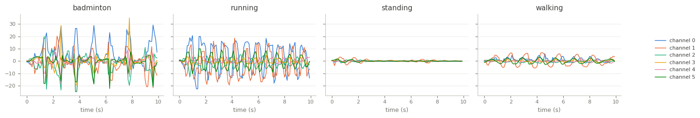

BasicMotions
============

.. raw:: html

   

   
   
   
   
   

Overview
--------

Multivariate time series classification dataset from the UEA archive (Bagnall et al., 2018). It was
recorded in a student project: four students performed four activities five times each while wearing a
smart watch, which recorded the x, y and z axes of its accelerometer and its gyroscope (6 channels) at
10 Hz for 10 seconds.

The archive does not document which channels belong to the accelerometer and which to the gyroscope,
so the channels are kept in the archive's order. The loader passes the archive's data through unchanged.

- **Train**: 40 recordings (10 per class).
- **Test**: 40 recordings (10 per class).

Class names are the archive's labels in lower case: ``badminton``, ``running``, ``standing``, ``walking``.
(The archive's description calls ``standing`` "resting".)

Data Structure
--------------

.. list-table::
   :header-rows: 1
   :widths: 20 20 60

   * - Key
     - Type
     - Description
   * - ``series``
     - list of list of float32
     - Smart watch recording, shape ``(100, 6)``: time steps by channels
   * - ``label``
     - int
     - Activity class (0-3)

Usage Example
-------------

.. code-block:: python

    import numpy as np
    from stable_datasets.timeseries import BasicMotions

    train = BasicMotions(split="train")
    sample = train[0]
    x = np.asarray(sample["series"])  # (100, 6)
    print(x.shape, train.features["label"].names[sample["label"]])

References
----------

- Homepage: https://timeseriesclassification.com/description.php?Dataset=BasicMotions
- Archive record: https://doi.org/10.5281/zenodo.11206179
- License: CC BY 4.0

Citation
--------

.. code-block:: bibtex

    @article{bagnall2018uea,
      title={The UEA multivariate time series classification archive, 2018},
      author={Bagnall, Anthony and Dau, Hoang Anh and Lines, Jason and Flynn, Michael and Large, James and Bostrom, Aaron and Southam, Paul and Keogh, Eamonn},
      journal={arXiv preprint arXiv:1811.00075},
      year={2018}
    }
