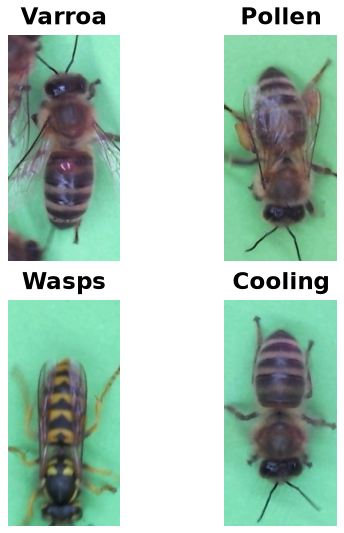

BeeDataset
==========

.. raw:: html

   

   
   
   
   

Overview
--------

The BeeDataset contains images of bees annotated with four binary labels. Each label represents a separate attribute, allowing an image to have multiple positive labels.

The dataset provides the following labels:

- **varroa**
- **pollen**
- **wasps**
- **cooling**

 **Train**: 7,490 images (the dataset has no official validation or test split)

Data Structure
--------------

When accessing an example using ``ds[i]``, you will receive a dictionary with the following keys:

.. list-table::
   :header-rows: 1
   :widths: 20 20 60

   * - Key
     - Type
     - Description
   * - ``image``
     - ``PIL.Image.Image``
     - Image of a bee.
   * - ``varroa``
     - int
     - Binary label indicating the presence or absence of varroa.
   * - ``pollen``
     - int
     - Binary label indicating the presence or absence of pollen.
   * - ``wasps``
     - int
     - Binary label indicating the presence or absence of wasps.
   * - ``cooling``
     - int
     - Binary label indicating the cooling-related annotation.

Usage Example
-------------

**Basic Usage**

.. code-block:: python

   from stable_datasets.images.bee_dataset import BeeDataset

   # Load the training split
   ds = BeeDataset(split="train")

   sample = ds[0]
   print(sample.keys())

   # Optional: make it PyTorch-friendly
   ds_torch = ds.with_format("torch")

References
----------

- Dataset website: https://github.com/BeeAlarmed/BeeDataset?tab=readme-ov-file
- Tensorflow information source: https://www.tensorflow.org/datasets/catalog/bee_dataset
- Original dataset source - deprecated : https://raspbee.de 
- License:  GPL-3.0 LICENSE

Citation
--------

.. code-block:: bibtex

  @misc{beealarmed2021,
      title = {Dataset for a camera based bee-hive monitoring},
      author = {Fabian Hickert},
      year = {2021},
      journal = {BeeAlarmed},
      url = {https://github.com/BeeAlarmed}
  }
