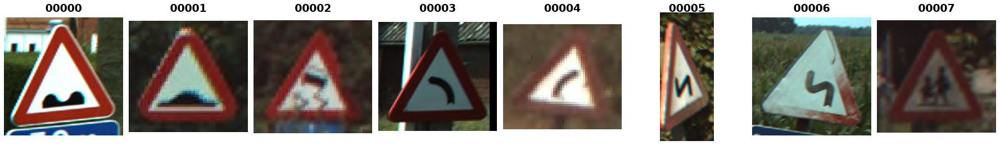

BelgiumTSC
==========

.. raw:: html

   

   
   
   
   

Overview
--------

BelgiumTSC (Belgium Traffic Sign Classification) is a traffic sign recognition benchmark built from the BelgiumTS street-view database and laid out like GTSRB. Each image is an RGB crop of a single sign with a border of 10% of the sign size (at least 5 pixels) around it, and image sizes vary (from 22×20 to 724×529, median about 107×96). On average there are about 3 views of each physical sign, taken from different positions of the capture vehicle.

- **Train**: 4,575 images
- **Test**: 2,520 images
- **Classes**: 62

The official Training/Testing partitions are kept as released. All 62 classes appear in the training split, but only 53 appear in the test split. The per-class ``GT-*.csv`` annotation files list 16 training and 14 test images that are missing from the archives, so the builder enumerates the images themselves and takes the label from the class folder. The annotated sign bounding boxes are not included.

Data Structure
--------------

When accessing an example using ``ds[i]``, you will receive a dictionary with the following keys:

.. list-table::
   :header-rows: 1
   :widths: 20 20 60

   * - Key
     - Type
     - Description
   * - ``image``
     - ``PIL.Image.Image``
     - Variable-size RGB crop of a traffic sign
   * - ``label``
     - int
     - Class label (0-61), named after the official class folder (``"00000"``-``"00061"``)

Usage Example
-------------

**Basic Usage**

.. code-block:: python

    from stable_datasets.images.belgium_tsc import BelgiumTSC

    # First run will download + prepare cache, then return the split as a HF Dataset
    ds_train = BelgiumTSC(split="train")
    ds_test = BelgiumTSC(split="test")

    # If you omit the split (split=None), you get a DatasetDict with all available splits
    ds_all = BelgiumTSC(split=None)

    sample = ds_train[0]
    print(sample.keys())  # {"image", "label"}
    print(sample["image"].size)  # varies per image, e.g. (142, 141)

    # Optional: make it PyTorch-friendly
    ds_train_torch = ds_train.with_format("torch")

References
----------

- Homepage: https://btsd.ethz.ch/shareddata/

Citation
--------

.. code-block:: bibtex

    @inproceedings{timofte2011sparse,
      title={Sparse representation based projections},
      author={Timofte, Radu and Van Gool, Luc},
      booktitle={British Machine Vision Conference},
      year={2011}
    }

    @article{timofte2014multi,
      title={Multi-view traffic sign detection, recognition, and 3D localisation},
      author={Timofte, Radu and Zimmermann, Karel and Van Gool, Luc},
      journal={Machine Vision and Applications},
      volume={25},
      number={3},
      pages={633--647},
      year={2014}
    }
