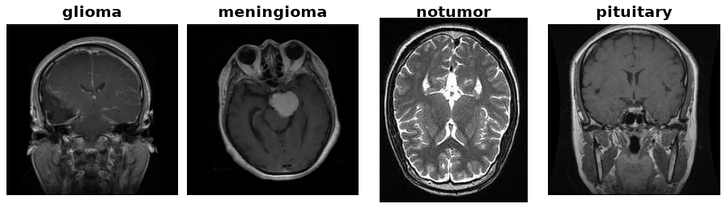

Brain Tumor MRI
===============

.. raw:: html

   

   
   
   
   

Overview
--------

The Brain Tumor MRI dataset was put together by Masoud Nickparvar from three older datasets (Figshare, SARTAJ and Br35H). It has 7,200 brain MRI images in four classes: glioma, meningioma, pituitary tumor and no tumor. The training set has 1,400 images per class and the test set has 400 per class.

The images are kept exactly as published. They come in many sizes (most are 512x512) and are a mix of grayscale and color, so you will usually want to resize them and convert them to one color mode before training. Some images appear more than once, and 114 test images are also in the training set, which can make test accuracy look a little better than it really is.

Data Structure
--------------

Each example ``ds[i]`` is a dictionary with these keys:

.. list-table::
   :header-rows: 1
   :widths: 20 20 60

   * - Key
     - Type
     - Description
   * - ``image``
     - ``PIL.Image.Image``
     - MRI image in its original size and color mode
   * - ``label``
     - int
     - 0 glioma, 1 meningioma, 2 notumor, 3 pituitary

Usage Example
-------------

.. code-block:: python

    from stable_datasets.images import BrainTumorMRI

    ds_train = BrainTumorMRI(split="train")
    ds_test = BrainTumorMRI(split="test")

    sample = ds_train[0]
    image = sample["image"].convert("RGB").resize((224, 224))
    print(sample["label"])

References
----------

The dataset is on Kaggle at https://www.kaggle.com/datasets/masoudnickparvar/brain-tumor-mri-dataset under the CC BY 4.0 license. The builder downloads version 2 of it, and no Kaggle account is needed.

Citation
--------

.. code-block:: bibtex

    @misc{nickparvar2021braintumor,
      title={Brain Tumor MRI Dataset},
      author={Nickparvar, Masoud},
      year={2021},
      publisher={Kaggle},
      howpublished={\url{https://www.kaggle.com/datasets/masoudnickparvar/brain-tumor-mri-dataset}}
    }
