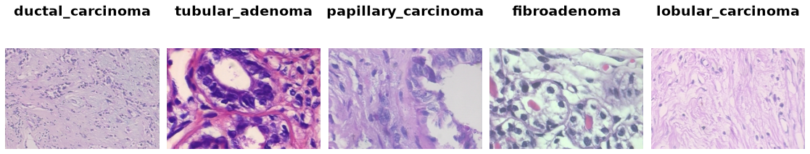

BreakHis
========

.. raw:: html

   

   
   
   
   
   

Overview
--------

The Breast Cancer Histopathological Image Classification (BreakHis) dataset contains 7,909 microscopic images of breast tumour tissue, collected from hematoxylin and eosin stained biopsy slides of 82 patients at the P&D Laboratory, Brazil. Each slide was imaged at four magnifications (40X, 100X, 200X and 400X). Each image is an RGB PNG of 700x460 pixels (74 images are 700x456), labelled with one of eight tumour types, four benign and four malignant.

- **License**: CC BY 4.0 (stated on the homepage); cite the original paper when using the data
- **Folds**: the authors' five train/test folds used in the paper, downloaded from the homepage. Each fold keeps all images of a slide (one patient ID and tumour type) in the same split. Select a fold with ``config_name="fold1"`` (the default) to ``"fold5"``:

.. list-table::
   :header-rows: 1
   :widths: 20 40 40

   * - Fold
     - Train images
     - Test images
   * - ``fold1``
     - 5,005
     - 2,904
   * - ``fold2``
     - 5,506
     - 2,403
   * - ``fold3``
     - 5,332
     - 2,577
   * - ``fold4``
     - 5,211
     - 2,698
   * - ``fold5``
     - 4,826
     - 3,083

Data Structure
--------------

When accessing an example using ``ds[i]``, you receive a dictionary with the following keys:

.. list-table::
   :header-rows: 1
   :widths: 20 25 55

   * - Key
     - Type
     - Description
   * - ``image``
     - ``PIL.Image.Image``
     - RGB histopathology image, 700x460 (74 images are 700x456)
   * - ``label``
     - int
     - Tumour type, 0-7 (see Classes); ``label < 4`` is benign
   * - ``malignant``
     - int
     - ``0`` (benign) or ``1`` (malignant), for the binary task
   * - ``magnification``
     - int
     - ``0`` (40X), ``1`` (100X), ``2`` (200X) or ``3`` (400X)
   * - ``patient_id``
     - str
     - Patient ID from the file name, e.g. ``"14-22549AB"``

Classes
-------

.. list-table::
   :header-rows: 1
   :widths: 10 30 20 40

   * - Label
     - Tumour type
     - Benign/malignant
     - Train / test images (``fold1``)
   * - 0
     - adenosis
     - benign
     - 253 / 191
   * - 1
     - fibroadenoma
     - benign
     - 683 / 331
   * - 2
     - phyllodes_tumor
     - benign
     - 218 / 235
   * - 3
     - tubular_adenoma
     - benign
     - 318 / 251
   * - 4
     - ductal_carcinoma
     - malignant
     - 2,313 / 1,138
   * - 5
     - lobular_carcinoma
     - malignant
     - 302 / 324
   * - 6
     - mucinous_carcinoma
     - malignant
     - 547 / 245
   * - 7
     - papillary_carcinoma
     - malignant
     - 371 / 189

Usage Example
-------------

.. code-block:: python

    from stable_datasets.images import BreakHis

    # Downloads the 4.3 GB archive on first use; config_name defaults to "fold1"
    ds = BreakHis(split="train")
    test_fold3 = BreakHis(config_name="fold3", split="test")
    sample = ds[0]

    print(sample.keys())          # dict_keys(["image", "label", "malignant", "magnification", "patient_id"])
    print(sample["image"].size)   # (700, 460), or (700, 456) for 74 images
    print(sample["label"])        # tumour type, 0-7

    # Binary benign/malignant task at one magnification
    ds_200x = ds.filter(lambda ex: ex["magnification"] == 2)
    binary_label = ds_200x[0]["malignant"]

    # Load as PyTorch tensors
    ds_torch = ds.with_format("torch")
    print(ds_torch[0]["image"].shape)  # 3 x 460 x 700

Citation
--------

.. code-block:: bibtex

    @article{spanhol2016dataset,
        title={A Dataset for Breast Cancer Histopathological Image Classification},
        author={Spanhol, Fabio A and Oliveira, Luiz S and Petitjean, Caroline and Heutte, Laurent},
        journal={IEEE Transactions on Biomedical Engineering},
        volume={63},
        number={7},
        pages={1455--1462},
        year={2016},
        publisher={IEEE}
    }
