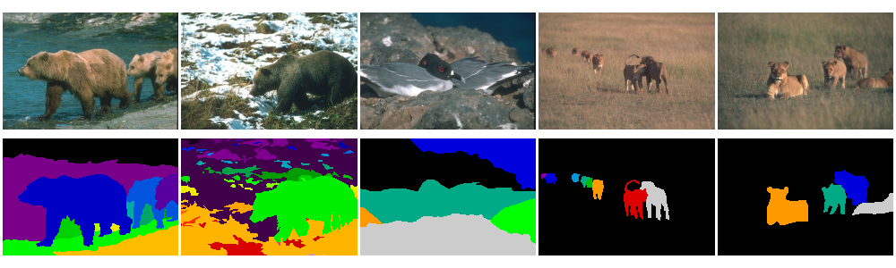

BSDS500
=======

.. raw:: html

   

   
   
   
   

Overview
--------

The Berkeley Segmentation Dataset and Benchmark (BSDS500) is a standard benchmark for unsupervised image segmentation and boundary (contour) detection. It contains 500 natural RGB images of size 481×321 or 321×481. Each image comes with 4 to 9 segmentations drawn independently by different people. There are no class labels: regions are numbered, not named.

- **Train**: 200 images
- **Validation**: 100 images
- **Test**: 200 images

Every human segmentation is given in two forms:

- a **region map**: each pixel holds the number of the region it belongs to (1, 2, 3, ...)
- a **boundary map**: 1 on region edges, 0 elsewhere

Data Structure
--------------

When accessing an example using ``ds[i]``, you will receive a dictionary with the following keys:

.. list-table::
   :header-rows: 1
   :widths: 20 20 60

   * - Key
     - Type
     - Description
   * - ``image``
     - ``PIL.Image.Image``
     - 481×321 or 321×481 RGB image
   * - ``image_id``
     - str
     - Original BSDS500 file name without extension (e.g. ``"100075"``)
   * - ``segmentations``
     - list[bytes]
     - One PNG-encoded region map per annotator; decode with ``decode_mask``
   * - ``boundaries``
     - list[bytes]
     - One PNG-encoded boundary map per annotator; decode with ``decode_mask``

The number of annotators varies between images, so ``segmentations`` and ``boundaries`` are lists of varying length (always equal to each other). ``decode_mask`` returns a 2-D ``uint16`` NumPy array with the same height and width as the image.

Usage Example
-------------

**Basic Usage**

.. code-block:: python

    from stable_datasets.images import BSDS500
    from stable_datasets.images.bsds500 import decode_mask

    # First run will download + prepare cache, then return the split
    ds = BSDS500(split="train")

    # If you omit the split (split=None), you get a dict with all splits:
    # "train", "validation", "test"
    ds_all = BSDS500(split=None)

    sample = ds[0]
    print(sample.keys())  # {"image", "image_id", "segmentations", "boundaries"}

    # Decode the human annotations into 2-D integer arrays
    regions = [decode_mask(b) for b in sample["segmentations"]]
    edges = [decode_mask(b) for b in sample["boundaries"]]
    print(len(regions), regions[0].shape)  # e.g. 6 (321, 481)

Evaluation
----------

Segmentations are usually evaluated against all human annotations of an image with segmentation covering, the probabilistic Rand index, and variation of information; boundaries with precision/recall and F-measure. The official MATLAB benchmark code is included in the original download (``BSR/bench``); see Arbeláez et al. (2011) for the protocol.

References
----------

- Official website: https://www2.eecs.berkeley.edu/Research/Projects/CS/vision/grouping/resources.html
- Original BSDS300 (the first 300 images): https://www2.eecs.berkeley.edu/Research/Projects/CS/vision/bsds/

Citation
--------

.. code-block:: bibtex

    @article{arbelaez2011contour,
      title={Contour Detection and Hierarchical Image Segmentation},
      author={Arbel{\'a}ez, Pablo and Maire, Michael and Fowlkes, Charless and Malik, Jitendra},
      journal={IEEE Transactions on Pattern Analysis and Machine Intelligence},
      volume={33},
      number={5},
      pages={898--916},
      year={2011}
    }
