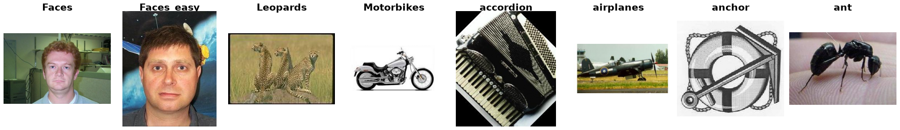

Caltech-101
===========

.. raw:: html

   

   
   
   
   

Overview
--------
Caltech-101 contains pictures of objects belonging to 101 categories, collected by Fei-Fei Li, Marco Andreetto, and Marc'Aurelio Ranzato in 2003. Most categories have about 40 to 800 images, and most images are roughly 300x200 pixels. It is widely used to evaluate transfer learning and pretrained representations.

The archive also ships a ``BACKGROUND_Google`` clutter category. It is **excluded**, as in torchvision, leaving 8677 images in the 101 object classes. ``Faces`` and ``Faces_easy`` are kept as two separate classes. Grayscale images are converted to RGB.

- **Train**: 3030 images (30 per class)
- **Test**: 5647 images

Train/Test Split
----------------

Caltech-101 has no official train/test split, so this builder defines its own: **30 random training images per class, with all remaining images used for testing**.

The split is deterministic. Classes are visited in sorted order, the file names in each class are sorted and then shuffled with ``random.Random(0)`` (``SPLIT_SEED`` in ``stable_datasets/images/caltech101.py``), and the first 30 go to ``train``. Every class has at least 31 images, so every class appears in the test split.

The test split is imbalanced (for example ``airplanes`` and ``Motorbikes`` have about 770 test images, while ``inline_skate`` has 1), so **mean per-class accuracy** can differ from overall top-1 accuracy by a few points.

Papers that report Caltech-101 results often use a different split (for example, 102 classes including ``BACKGROUND_Google``, or a different random draw), so their numbers are not directly comparable with results on this split.

Data Structure
--------------

When accessing an example using ``ds[i]``, you will receive a dictionary with the following keys:

.. list-table::
   :header-rows: 1
   :widths: 20 20 60

   * - Key
     - Type
     - Description
   * - ``image``
     - ``PIL.Image.Image``
     - H×W×3 RGB image (variable size)
   * - ``label``
     - int
     - Class label (0-100)

Usage Example
-------------

**Basic Usage**

.. code-block:: python

    from stable_datasets.images.caltech101 import Caltech101

    # First run will download + prepare cache, then return the split
    ds = Caltech101(split="train")

    # If you omit the split (split=None), you get a StableDatasetDict with all available splits
    ds_all = Caltech101(split=None)

    sample = ds[0]
    print(sample.keys())  # {"image", "label"}
    print(ds.features["label"].names[sample["label"]])

    # Optional: make it PyTorch-friendly
    ds_torch = ds.with_format("torch")

References
----------

- Official website: https://data.caltech.edu/records/mzrjq-6wc02
- Download: ``caltech-101.zip`` (MD5 ``3138e1922a9193bfa496528edbbc45d0``)
- License: CC BY 4.0

Citation
--------

.. code-block:: bibtex

    @article{fei2006one,
        title     = {One-shot learning of object categories},
        author    = {Fei-Fei, Li and Fergus, Rob and Perona, Pietro},
        journal   = {IEEE Transactions on Pattern Analysis and Machine Intelligence},
        volume    = {28},
        number    = {4},
        pages     = {594--611},
        year      = {2006},
        doi       = {10.1109/TPAMI.2006.79}}
