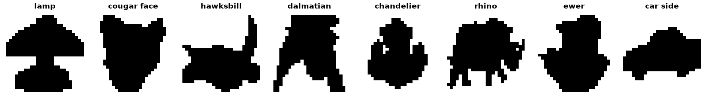

Caltech-101 Silhouettes
=======================

.. raw:: html

   

   
   
   
   

Overview
--------

CalTech 101 Silhouettes is a shape classification dataset derived from the Caltech-101 object annotations. Each Caltech-101 image comes with a high-quality polygon outline of its primary object; the outline is centered, scaled and rendered as a filled black polygon on a white background at 28×28 pixels. Outlines producing images that are more than 90% white or black were dropped by the authors.

The dataset uses the authors' official stratified split (``split1``). Each class contributes min(3/5 · N\ :sub:`c`, 100) images to the training set and the remainder is divided evenly between validation and test, so the evaluation splits are class-imbalanced:

- **Train**: 4,100 images (19-100 per class)
- **Validation**: 2,264 images (6-349 per class)
- **Test**: 2,307 images (6-349 per class)

Because of this imbalance, the authors recommend reporting class-balanced accuracy. A few classes (e.g. soccer ball, pizza, stop sign, yin yang) are indistinguishable by shape alone.

Data Structure
--------------

When accessing an example using ``ds[i]``, you will receive a dictionary with the following keys:

.. list-table::
   :header-rows: 1
   :widths: 20 20 60

   * - Key
     - Type
     - Description
   * - ``image``
     - ``PIL.Image.Image``
     - 28×28 grayscale binary silhouette (0 = object, 255 = background)
   * - ``label``
     - int
     - Class label (0-100)

Preprocessing
-------------

The source ``.mat`` file stores each image as a flattened binary vector in column-major (MATLAB) order with 1-based labels. The builder:

- reshapes images in Fortran order so silhouettes are upright,
- scales pixel values from {0, 1} to {0, 255}, keeping the original black-object-on-white-background rendering,
- shifts labels from 1-101 to 0-100,
- keeps class names verbatim from the source ``classnames`` field (e.g. ``"Faces 2"``, ``"car side"``).

Usage Example
-------------

**Basic Usage**

.. code-block:: python

    from stable_datasets.images.caltech101_silhouettes import Caltech101Silhouettes

    ds_train = Caltech101Silhouettes(split="train")
    ds_val = Caltech101Silhouettes(split="validation")
    ds_test = Caltech101Silhouettes(split="test")

    sample = ds_train[0]
    print(sample.keys())  # {"image", "label"}
    print(ds_train.info.features["label"].names[sample["label"]])  # "lamp"

    # Optional: make it PyTorch-friendly
    ds_torch = ds_train.with_format("torch")

Benchmark Validation
--------------------

The dataset is registered in the SSL benchmark as ``caltech101silhouettes``:

.. code-block:: bash

    python -m benchmarks.run model=simclr dataset=caltech101silhouettes

**Protocol.** SimCLR with a ViT-S/16 backbone was trained from scratch for 150 epochs with the default harness config (batch size 256). The representation is scored with a standard linear evaluation on frozen features:

- extract backbone features of clean images (the benchmark's validation transform, no augmentation) for all three splits,
- standardize the features and fit a linear classifier on the train split (AdamW, lr 1e-3, batch size 256, 300 epochs),
- choose weight decay from {1e-4, 1e-3, 1e-2, 1e-1} by validation accuracy,
- report test accuracy for the chosen setting, mean ± std over 3 seeds.

Accuracy is class-balanced (``MulticlassAccuracy``, as in the benchmark), which is the metric the authors recommend for the imbalanced evaluation splits. Chance is about 1%.

.. list-table::
   :header-rows: 1
   :widths: 50 25 25

   * - Probe (test split)
     - Balanced top-1 (%)
     - Plain top-1 (%)
   * - Frozen-feature linear probe (3 seeds)
     - **49.1 ± 0.9**
     - 63.0 ± 0.4
   * - Benchmark online probe
     - 5.2
     - 27.0

The checkpoint is from epoch 100 of 150: the harness checks every 10 epochs and, with ``monitor`` set and ``save_top_k=1``, writes ``last.ckpt`` only when the monitored online-probe metric has improved, which last happened at epoch 100.

**Why not the online probe.** The benchmark's online probe gets one optimizer step per training batch. With 4,100 training images (16 batches per epoch), it receives about 1,600 updates by epoch 100 and stays near chance (training loss 4.2 against 4.6 for uniform guessing over 101 classes), even though the run's k-NN probe ends at 28% (validation) and the frozen-feature probe reaches 49%. It also trains only on the SimCLR views, whose crops down to 8% of the image often remove most of a 28×28 silhouette; a converged probe fit on augmented views scores about 20 points lower than one fit on clean images.

References
----------

- Homepage: https://people.cs.umass.edu/~marlin/data.shtml
- Paper: Inductive Principles for Restricted Boltzmann Machine Learning (AISTATS 2010)
- License: No explicit license is stated by the authors. The underlying Caltech-101 annotations are released under CC BY 4.0 (https://data.caltech.edu/records/mzrjq-6wc02).

Citation
--------

.. code-block:: bibtex

    @inproceedings{marlin2010inductive,
      title={Inductive Principles for Restricted Boltzmann Machine Learning},
      author={Marlin, Benjamin and Swersky, Kevin and Chen, Bo and de Freitas, Nando},
      booktitle={Proceedings of the Thirteenth International Conference on Artificial Intelligence and Statistics},
      pages={509--516},
      year={2010},
      volume={9},
      series={Proceedings of Machine Learning Research},
      publisher={PMLR}
    }
