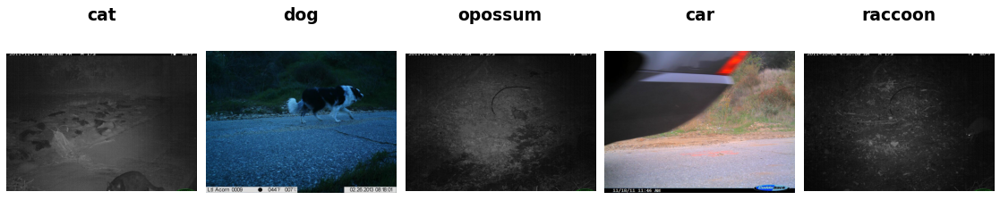

Caltech Camera Traps (CCT20)
============================

.. raw:: html

   

   
   
   
   

Overview
--------

CCT20 is the camera-trap benchmark introduced in "Recognition in Terra Incognita" (ECCV 2018). It contains 57,864 images from 20 camera locations in the Southwestern United States, taken by motion- and heat-triggered cameras by day and by night (infrared). The images in this builder are the authors' reduced-size release, 1024 pixels wide.

Its official splits test generalization to new environments: besides the training split, there are validation and test splits at the 10 training locations ("cis") and at 10 locations never seen in training ("trans").

- **Train**: 13,546 images (10 locations)
- **Validation** (``cis_val``): 2,489 images (training locations)
- **Test** (``cis_test``): 14,646 images (training locations)
- **trans_validation** (``trans_val``): 1,603 images (1 unseen location)
- **trans_test**: 21,488 images (9 unseen locations)

Data Structure
--------------

When accessing an example using ``ds[i]``, you will receive a dictionary with the following keys:

.. list-table::
   :header-rows: 1
   :widths: 20 20 60

   * - Key
     - Type
     - Description
   * - ``image``
     - ``PIL.Image.Image``
     - RGB camera-trap image, 1024×747 or 1024×768
   * - ``label``
     - int
     - Class label (0-14)
   * - ``location``
     - int
     - Camera location id, e.g. to analyze results per location

Classes
-------

.. list-table::
   :header-rows: 1
   :widths: 15 40 45

   * - Label
     - Class Name
     - Training Images
   * - 0
     - opossum
     - 2,726
   * - 1
     - raccoon
     - 1,027
   * - 2
     - squirrel
     - 1,249
   * - 3
     - bobcat
     - 785
   * - 4
     - skunk
     - 229
   * - 5
     - dog
     - 820
   * - 6
     - coyote
     - 1,403
   * - 7
     - rabbit
     - 2,443
   * - 8
     - bird
     - 484
   * - 9
     - cat
     - 1,287
   * - 10
     - badger
     - 3
   * - 11
     - car
     - 668
   * - 12
     - deer
     - 42
   * - 13
     - fox
     - 5
   * - 14
     - rodent
     - 375

The classes are strongly imbalanced (badger and fox have fewer than 10 training images), so report per-class or class-balanced metrics alongside accuracy.

Usage Example
-------------

**Basic Usage**

.. code-block:: python

    from stable_datasets.images import CCT20

    train_ds = CCT20(split="train")
    val_ds = CCT20(split="validation")  # cis_val: locations seen in training
    test_ds = CCT20(split="test")  # cis_test: locations seen in training

    sample = train_ds[0]
    print(sample.keys())  # {"image", "label", "location"}

**Generalization to Unseen Locations**

.. code-block:: python

    from stable_datasets.images import CCT20

    seen = CCT20(split="test")  # cis_test
    unseen = CCT20(split="trans_test")  # 9 camera locations never seen in training

**Getting Class Names**

.. code-block:: python

    from stable_datasets.images import CCT20

    ds = CCT20(split="train")
    class_names = ds.info.features["label"].names
    print(class_names[ds[0]["label"]])

Notes
-----

- **Excluded images**: images labeled ``empty`` are excluded. The class has no training images (it occurs only in the validation and test splits), so a classifier trained on this data could never predict it. The 78 images annotated with more than one category are excluded as well, since each example has a single label. Without these exclusions the splits contain 13,553 / 3,484 / 15,827 / 1,725 / 23,275 images.
- **Grayscale images**: 551 night-time infrared images are grayscale in the source archive; the builder converts them to RGB so that every image has three channels.
- **Near-duplicates in the validation split**: camera traps take short bursts of photos. 224 such bursts have frames in both ``train`` and ``cis_val``, so the official validation split contains near-duplicates of training images. ``cis_test`` and the ``trans`` splits have no such overlap.
- **Hosting**: the archives (6.5 GB of images, 3 MB of annotations) are downloaded from LILA's Google Cloud Storage bucket, with LILA's Azure mirror as fallback, and verified with MD5 checksums.

References
----------

- Homepage: https://lila.science/datasets/caltech-camera-traps
- Benchmark page: https://beerys.github.io/CaltechCameraTraps/
- License: Community Data License Agreement – Permissive, Version 1.0 (CDLA-Permissive-1.0)

Citation
--------

.. code-block:: bibtex

    @inproceedings{beery2018recognition,
      title = {Recognition in Terra Incognita},
      author = {Beery, Sara and Van Horn, Grant and Perona, Pietro},
      booktitle = {Proceedings of the European Conference on Computer Vision (ECCV)},
      year = {2018}
    }
