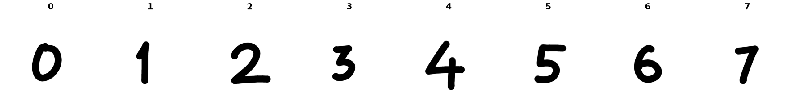

Chars74K EnglishHnd
===================

Overview
--------

Chars74K EnglishHnd is a handwritten character recognition
dataset containing 3,410 images across 62 character classes.

The classes include digits (0-9), uppercase letters (A-Z),
and lowercase letters (a-z).

Dataset statistics:

- Total samples: 3,410
- Training samples: 2,728
- Test samples: 682
- Number of classes: 62
- Original images: variable resolution
- Task: image classification

Data Structure
--------------

Each sample is returned as a dictionary:

.. list-table::
   :header-rows: 1

   * - Key
     - Type
     - Description
   * - ``image``
     - ``PIL.Image.Image``
     - RGB handwritten character image
   * - ``label``
     - int
     - Class index from 0 to 61

Label Mapping
-------------

The dataset uses 62 class folders, named
``Sample001`` through ``Sample062``.

- ``Sample001`` to ``Sample010``: digits 0-9
- ``Sample011`` to ``Sample036``: uppercase letters A-Z
- ``Sample037`` to ``Sample062``: lowercase letters a-z

The builder maps each class to the corresponding
zero-based class index.

Train/Test Split
----------------

This implementation uses a deterministic 80/20 split
within each class, based on the image filename number.

Images with ``(sample_id - 1) % 5 == 0`` belong to
the test split; all other images belong to the
training split.

Each class contains 44 training samples and
11 test samples.

This is a custom split, not an official benchmark split.
The same rule is used consistently across runs.

Usage Example
-------------

.. code-block:: python

   from stable_datasets.images import Chars74K

   train_ds = Chars74K(split="train")
   test_ds = Chars74K(split="test")

   print(len(train_ds))  # 2728
   print(len(test_ds))   # 682

   sample = train_ds[0]
   image = sample["image"]
   label = sample["label"]

   print(image.size, image.mode)
   print(label)

Validation
----------

The dataset was validated using offline unit tests,
full archive inspection, and supervised CNN training.

A small CNN was trained using:

- Epochs: 10
- Batch size: 32
- Optimizer: Adam
- Learning rate: 0.001
- Loss: CrossEntropyLoss
- Input resolution: 64 x 64 RGB
- Random seed: 42

Benchmark results:

- Test accuracy: 64.52%
- Test cross-entropy loss: 2.0381

The experiment was run using PyTorch MPS on Apple Silicon.

The 8-epoch run achieved 62.02% test accuracy and
1.8814 test loss. Extending training to 10 epochs
improved accuracy to 64.52%, while test loss increased.
These exploratory runs used the same test split.

To reproduce the 10-epoch benchmark, run:

.. code-block:: bash

   python examples/chars74k_train_eval.py

References
----------

- `Chars74K dataset <https://teodecampos.github.io/chars74k/>`_
- `EnglishHnd archive <https://info-ee.surrey.ac.uk/CVSSP/demos/chars74k/EnglishHnd.tgz>`_

The original dataset is associated with the work
"Character Recognition in Natural Images"
by de Campos, Babu, and Varma (2009).
