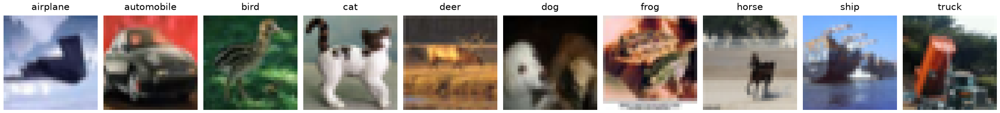

CIFAR-10.1
==========

.. raw:: html

   

   
   
   
   

Overview
--------

CIFAR-10.1 contains fresh test images for evaluating models trained on
CIFAR-10. This builder provides the **v6 release**, with 2,000 images
and exactly 200 examples per class. It has a **test split only**; there
is no training or validation split.

The images are 32x32 RGB images and use the same ten labels as CIFAR-10.
The figure below shows one image from each class in the CIFAR-10.1 test set.

Data Structure
--------------

Each example returned by ``ds[i]`` has these keys:

.. list-table::
   :header-rows: 1
   :widths: 20 25 55

   * - Key
     - Type
     - Description
   * - ``image``
     - ``PIL.Image.Image``
     - RGB image; converting it to NumPy gives shape (32, 32, 3) and dtype uint8.
   * - ``label``
     - ``int``
     - Class index from 0 to 9.

The label order is airplane, automobile, bird, cat, deer, dog, frog,
horse, ship, and truck.

Usage Example
-------------

.. code-block:: python

    import numpy as np

    from stable_datasets.images import CIFAR10_1

    ds = CIFAR10_1(split="test")
    print(len(ds))  # 2000

    sample = ds[0]
    image = np.asarray(sample["image"])
    print(image.shape, image.dtype)  # (32, 32, 3) uint8
    class_names = ds.info.features["label"].names
    print(class_names[sample["label"]])

To evaluate distribution shift, train and select the model using the original
CIFAR-10 data, then evaluate it on CIFAR-10.1 without fitting or tuning on this
test set.

License
-------

The upstream repository's MIT license covers its code, **not its images or
labels**. Its `license section <https://github.com/modestyachts/CIFAR-10.1#license>`_
refers image use to the Tiny Images dataset without naming a separate data
license. The builder therefore reports ``license="Unknown"``; it does not
claim that the dataset is MIT-licensed.

Related Datasets
----------------

- :doc:`cifar10`: Original CIFAR-10 training and test data.
- :doc:`cifar10_2`: Another CIFAR-10 reproduction with training and test splits.
- :doc:`cifar10_c`: CIFAR-10 images with common synthetic corruptions.

References
----------

- `CIFAR-10.1 repository <https://github.com/modestyachts/CIFAR-10.1>`_
- `Do CIFAR-10 Classifiers Generalize to CIFAR-10? <https://arxiv.org/abs/1806.00451>`_

Citation
--------

.. code-block:: bibtex

    @article{recht2018cifar10,
      author={Recht, Benjamin and Roelofs, Rebecca and Schmidt, Ludwig and Shankar, Vaishaal},
      title={Do CIFAR-10 Classifiers Generalize to CIFAR-10?},
      journal={arXiv preprint arXiv:1806.00451},
      year={2018}
    }
