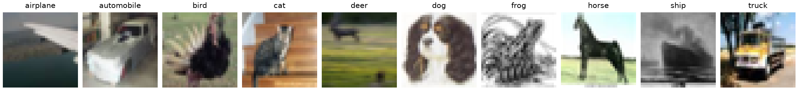

CIFAR-10.2
==========

.. raw:: html

   

   
   
   
   

Overview
--------

CIFAR-10.2 reproduces the CIFAR-10 collection process to study distribution
shift. It provides **10,000 training images** (1,000 per class) and
**2,000 test images** (200 per class). There is no separate validation split.

All images are 32x32 RGB images with the same ten labels as CIFAR-10.
The figure below shows one image from each class in the CIFAR-10.2 training set.

Data Structure
--------------

Each example returned by ``ds[i]`` has these keys:

.. list-table::
   :header-rows: 1
   :widths: 20 25 55

   * - Key
     - Type
     - Description
   * - ``image``
     - ``PIL.Image.Image``
     - RGB image; converting it to NumPy gives shape (32, 32, 3) and dtype uint8.
   * - ``label``
     - ``int``
     - Class index from 0 to 9.

The label order is airplane, automobile, bird, cat, deer, dog, frog,
horse, ship, and truck. The builder exposes the images and labels from
the upstream NPZ files; it does not expose their Tiny Images indices or keywords.

Usage Example
-------------

.. code-block:: python

    import numpy as np

    from stable_datasets.images import CIFAR10_2

    train_ds = CIFAR10_2(split="train")
    test_ds = CIFAR10_2(split="test")
    print(len(train_ds), len(test_ds))  # 10000 2000

    sample = train_ds[0]
    image = np.asarray(sample["image"])
    print(image.shape, image.dtype)  # (32, 32, 3) uint8
    class_names = train_ds.info.features["label"].names
    print(class_names[sample["label"]])

Train a classifier on the training split and report accuracy on the held-out
test split. If model selection needs a validation set, create it from the
training split.

License
-------

The `upstream repository <https://github.com/modestyachts/cifar-10.2>`_
does not include a license file or specify a data license in its README.
The builder reports ``license="Unknown"``. The images originate from Tiny
Images, but that provenance does not establish a license for this release.

Related Datasets
----------------

- :doc:`cifar10`: Original CIFAR-10 training and test data.
- :doc:`cifar10_1`: A separate CIFAR-10 reproduction with a test split only.
- :doc:`cifar10_c`: CIFAR-10 images with common synthetic corruptions.

References
----------

- `CIFAR-10.2 repository <https://github.com/modestyachts/cifar-10.2>`_
- `Harder or Different? A Closer Look at Distribution Shift in Dataset Reproduction <https://www.gatsby.ucl.ac.uk/~balaji/udl2020/accepted-papers/UDL2020-paper-101.pdf>`_,
  presented at the ICML 2020 Workshop on Uncertainty and Robustness in Deep Learning.

Citation
--------

.. code-block:: bibtex

    @inproceedings{lu2020harder,
      author={Lu, Shangyun and Nott, Bradley and Olson, Aaron and Todeschini, Alberto and
              Vahabi, Hossein and Carmon, Yair and Schmidt, Ludwig},
      title={Harder or Different? A Closer Look at Distribution Shift in Dataset Reproduction},
      booktitle={ICML Workshop on Uncertainty and Robustness in Deep Learning},
      year={2020},
      url={https://www.gatsby.ucl.ac.uk/~balaji/udl2020/accepted-papers/UDL2020-paper-101.pdf}
    }
