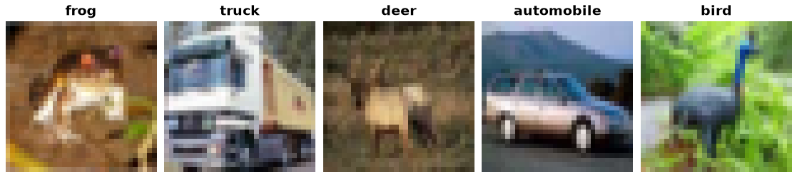

CIFAR-10N
=========

.. raw:: html

   

   
   
   
   

Overview
--------

CIFAR-10N pairs the 50,000 CIFAR-10 training images with the clean CIFAR-10 labels and five human annotation variants from the CIFAR-N release. It also provides the 10,000 standard CIFAR-10 test images and labels. The test examples have ``None`` for the human annotation fields because CIFAR-N annotations cover only training images.

- **Train**: 50,000 images (5,000 per class)
- **Test**: 10,000 images (1,000 per class)

Data Structure
--------------

When accessing an example using ``ds[i]``, you will receive a dictionary with the following keys:

.. list-table::
   :header-rows: 1
   :widths: 20 20 60

   * - Key
     - Type
     - Description
   * - ``image``
     - ``PIL.Image.Image``
     - 32x32x3 RGB image
   * - ``label``
     - int
     - Clean CIFAR-10 class label (0-9)
   * - ``aggre_label``
     - int or ``None``
     - Aggregated human annotation (0-9); ``None`` on the test split
   * - ``worse_label``
     - int or ``None``
     - Human annotation selected as the worst label (0-9); ``None`` on the test split
   * - ``random_label1``
     - int or ``None``
     - Human annotation from a randomly selected annotator (0-9); ``None`` on the test split
   * - ``random_label2``
     - int or ``None``
     - Human annotation from a randomly selected annotator (0-9); ``None`` on the test split
   * - ``random_label3``
     - int or ``None``
     - Human annotation from a randomly selected annotator (0-9); ``None`` on the test split

Usage Example
-------------

**Basic Usage**

.. code-block:: python

    from stable_datasets.images.cifar10_n import CIFAR10N

    train = CIFAR10N(split="train")
    test = CIFAR10N(split="test")
    sample = train[0]

    print(sample["label"], sample["aggre_label"], sample["worse_label"])
    print(sample["random_label1"], sample["random_label2"], sample["random_label3"])
    print(test[0]["aggre_label"])  # None: no human annotations are provided for test images

Related Datasets
----------------

- :doc:`cifar10`: CIFAR-10 with 10 classes
- :doc:`cifar100`: CIFAR-100 with 100 fine-grained classes
- :doc:`cifar10_c`: CIFAR-10-C corruption benchmark
- :doc:`cifar100_c`: CIFAR-100-C corruption benchmark
- :doc:`cifar100_n`: CIFAR-100 with real-world human annotations

References
----------

- CIFAR-N release: https://github.com/UCSC-REAL/cifar-10-100n
- CIFAR-10 dataset: https://www.cs.toronto.edu/~kriz/cifar.html
- Wei et al., *Learning with Noisy Labels Revisited: A Study Using Real-World Human Annotations*, ICLR 2022: https://openreview.net/forum?id=TBWA6PLJZQm

Citation
--------

.. code-block:: bibtex

    @inproceedings{wei2022learning,
      title={Learning with Noisy Labels Revisited: A Study Using Real-World Human Annotations},
      author={Jiaheng Wei and Zhaowei Zhu and Hao Cheng and Tongliang Liu and Gang Niu and Yang Liu},
      booktitle={International Conference on Learning Representations},
      year={2022},
      url={https://openreview.net/forum?id=TBWA6PLJZQm}
    }

