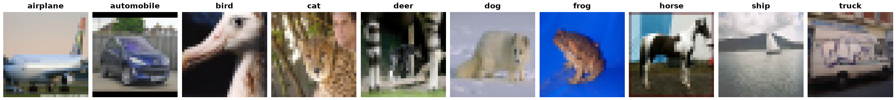

CINIC-10
========

.. raw:: html

   

   
   
   
   
   

Overview
--------

CINIC-10 (Darlow et al., 2018) extends CIFAR-10 to 270,000 32×32 RGB images over the same ten classes:
all 60,000 CIFAR-10 images plus 210,000 down-sampled ImageNet images. Each split (``train``,
``validation``, ``test``) has 90,000 class-balanced images, 20,000 of them from CIFAR-10.

Data Structure
--------------

When accessing an example using ``ds[i]``, you will receive a dictionary with the following keys:

.. list-table::
   :header-rows: 1
   :widths: 20 20 60

   * - Key
     - Type
     - Description
   * - ``image``
     - ``PIL.Image.Image``
     - 32×32×3 RGB image
   * - ``label``
     - int
     - Class label (0-9), same classes and order as CIFAR-10: airplane, automobile, bird, cat, deer, dog, frog, horse, ship, truck
   * - ``origin``
     - int
     - Image source, read from the release file names: ``0`` = ``cifar10``, ``1`` = ``imagenet``

About 0.1% of the ImageNet-derived images are grayscale in the release; the loader converts them to RGB.

Usage Example
-------------

.. code-block:: python

    from stable_datasets.images import CINIC10

    ds_train = CINIC10(split="train")
    ds_test = CINIC10(split="test")

    sample = ds_train[0]
    print(sample.keys())  # {"image", "label", "origin"}

References
----------

- Dataset record (Edinburgh DataShare): https://datashare.ed.ac.uk/handle/10283/3192 (DOI 10.7488/ds/2448)
- Paper: https://arxiv.org/abs/1810.03505
- License: CC BY 4.0

Citation
--------

.. code-block:: bibtex

    @article{darlow2018cinic,
      title   = {CINIC-10 is not ImageNet or CIFAR-10},
      author  = {Darlow, Luke N and Crowley, Elliot J and Antoniou, Antreas and Storkey, Amos J},
      journal = {arXiv preprint arXiv:1810.03505},
      year    = {2018}
    }
