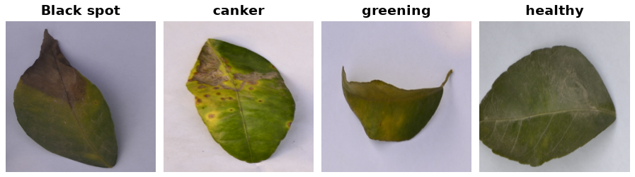

Citrus Leaves
=============

Overview
--------

CitrusLeaves exposes the 594 leaf PNG images in the downloaded Citrus archive.
The four classes are Black spot, canker, greening, and healthy. Fruit images
in the same archive are excluded. Images are RGB, 256 x 256 pixels.

All images are returned in the ``train`` split. The source does not provide
an official train/test partition; users should create their own holdout for
evaluation. The source landing page describes a larger collection; the
counts below refer specifically to the leaf files in this downloadable archive.

   One actual dataset image per class, generated with ``generate_teaser.py``.

.. list-table:: Class counts
   :header-rows: 1

   * - Label
     - Class
     - Train
   * - 0
     - Black spot
     - 169
   * - 1
     - canker
     - 163
   * - 2
     - greening
     - 204
   * - 3
     - healthy
     - 58

Data Structure
--------------

Each example is a dictionary containing:

- ``image``: a decoded RGB ``PIL.Image.Image``.
- ``label``: an integer from 0 to 3, in the class order above.

Usage Example
-------------

.. code-block:: python

    from stable_datasets.images import CitrusLeaves

    dataset = CitrusLeaves(split="train")
    sample = dataset[0]
    class_names = dataset.info.features["label"].names
    print(class_names[sample["label"]])

Reproduce the figure from the repository root:

.. code-block:: bash

    python generate_teaser.py --name CitrusLeaves --num-samples 4 --output docs/source/datasets/teasers/citrus_leaves_teaser.png

References
----------

- Homepage: https://data.mendeley.com/datasets/3f83gxmv57/2
- License: CC BY 4.0

Citation
--------

.. code-block:: bibtex

    @misc{rauf2019citrus,
        author = {Rauf, Hafiz Tayyab and Saleem, Basharat Ali and Lali, M. Ikram Ullah
                  and Khan, Muhammad Attique and Sharif, Muhammad and Bukhari, Syed Ahmad Chan},
        title = {A Citrus Fruits and Leaves Dataset for Detection and Classification
                 of Citrus Diseases through Machine Learning},
        year = {2019},
        publisher = {Mendeley Data},
        version = {2},
        doi = {10.17632/3f83gxmv57.2},
        url = {https://data.mendeley.com/datasets/3f83gxmv57/2}
    }
