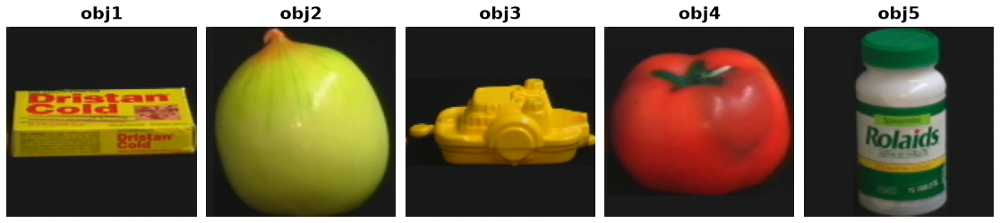

COIL-100 (Columbia Object Image Library)
=========================================

.. raw:: html

   

   
   
   
   
   

Overview
--------

COIL-100 contains 7,200 images of 100 physical objects. Each object has 72 RGB views, photographed at 5-degree increments around a full rotation. The distributed images are 128×128 pixels.

The only available split is ``train`` (7,200 examples). It represents the **entire official dataset**: Columbia does not provide a predefined train/test classification split.

Data Structure
--------------

Each example is a dictionary with these keys:

.. list-table::
   :header-rows: 1
   :widths: 20 20 60

   * - Key
     - Type
     - Description
   * - ``image``
     - ``PIL.Image.Image``
     - 128×128 RGB image
   * - ``label``
     - int
     - Zero-based object identity: original object 1 maps to 0, and object 100 maps to 99. Class names are ``obj1`` through ``obj100``.
   * - ``angle``
     - int
     - Viewpoint in degrees, from 0 to 355 in steps of 5

Usage Example
-------------

.. code-block:: python

    from stable_datasets.images import COIL100

    ds = COIL100(split="train")
    print(len(ds))  # 7200
    sample = ds[0]
    print(sample.keys())  # dict_keys(['image', 'label', 'angle'])
    print(sample["label"], sample["angle"])  # 0 0

References
----------

- Official Columbia COIL-100 page: https://www.cs.columbia.edu/CAVE/software/softlib/coil-100.php
- Official archive: https://www.cs.columbia.edu/CAVE/databases/SLAM_coil-20_coil-100/coil-100/coil-100.zip

Columbia does not state a clear SPDX-style license on the download page. Check with the data provider for applicable use terms.

Citation
--------

.. code-block:: bibtex

    @techreport{nene1996coil100,
      author = {Nene, Sameer A. and Nayar, Shree K. and Murase, Hiroshi},
      title = {Columbia Object Image Library (COIL-100)},
      institution = {Columbia University},
      number = {CUCS-006-96},
      month = feb,
      year = {1996}
    }
