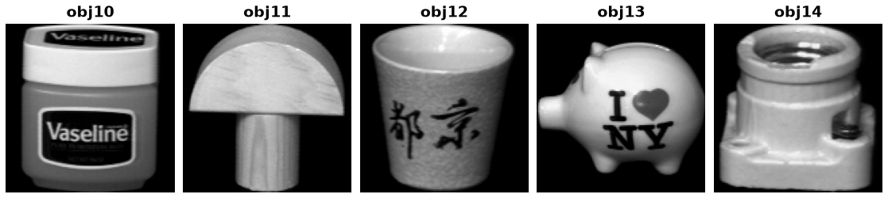

COIL-20
=======

Overview
--------

COIL-20 contains 1,440 grayscale images of 20 objects. Each object was
photographed from 72 views. The processed images are 128 × 128 pixels.

The source dataset does not provide an official train/test split. The
``train`` split in this builder contains all 1,440 images.

Data Structure
--------------

Each ``ds[i]`` returns:

.. list-table::
   :header-rows: 1

   * - Key
     - Type
     - Description
   * - ``image``
     - ``PIL.Image.Image``
     - 128 × 128 grayscale image
   * - ``label``
     - ``int``
     - Object class ID from 0 to 19
   * - ``view_id``
     - ``int``
     - View identifier read from the source filename

Usage Example
-------------

.. code-block:: python

    from stable_datasets.images import COIL20

    ds = COIL20(split="train")
    print(len(ds))  # 1440

    sample = ds[0]
    print(sample["image"].size, sample["label"], sample["view_id"])

License and Terms of Use
------------------------

No dataset-specific license was identified on the `official COIL-20 page
<https://www.cs.columbia.edu/CAVE/software/softlib/coil-20.php>`_ or in the
processed ZIP archive (checked October 29, 2026). The archive contains only
image files.

The `CAVE general copyright notice
<https://cave.cs.columbia.edu/copyright>`_ states that rights remain with the
authors or other copyright holders and that reposting generally requires
explicit permission. It does not specify a dataset license for COIL-20.
For clarification about permitted uses, contact the COIL maintainers at
webcave@lists.cs.columbia.edu, as listed on the official dataset page.

The stable-datasets repository license does not establish a license for
the downloaded dataset.

Source and Citation
-------------------

- Source: https://www.cs.columbia.edu/CAVE/software/softlib/coil-20.php
- S. A. Nene, S. K. Nayar, and H. Murase, *Columbia Object Image Library
  (COIL-20)*, Columbia University Technical Report CUCS-005-96, 1996.
