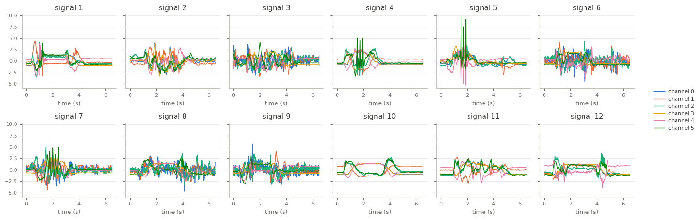

Cricket
=======

.. raw:: html

   

   
   
   
   
   

Overview
--------

Multivariate time series classification dataset from the UEA archive (Bagnall et al., 2018), introduced by
Ko et al. (2005). Cricket umpires signal events to a distant scorer with hand motions; for example, No-Ball is
signalled by touching each shoulder with the opposite hand. Four umpires performed twelve signals, ten times
each, with an accelerometer on each wrist: x, y and z acceleration of both wrists (6 channels) at 184 Hz,
1197 steps (about 6.5 seconds).

The archive does not document which channels belong to which wrist, so the channels are kept in the
archive's order. The loader passes the archive's data through unchanged.

- **Train**: 108 recordings (9 per class).
- **Test**: 72 recordings (6 per class).

The archive labels the signals ``1.0`` to ``12.0`` without naming them, so the class names are the numbers
``1`` to ``12``.

Data Structure
--------------

.. list-table::
   :header-rows: 1
   :widths: 20 20 60

   * - Key
     - Type
     - Description
   * - ``series``
     - list of list of float32
     - Wrist accelerometer recording, shape ``(1197, 6)``: time steps by channels
   * - ``label``
     - int
     - Signal class (0-11)

Usage Example
-------------

.. code-block:: python

    import numpy as np
    from stable_datasets.timeseries import Cricket

    train = Cricket(split="train")
    sample = train[0]
    x = np.asarray(sample["series"])  # (1197, 6)
    print(x.shape, train.features["label"].names[sample["label"]])

References
----------

- Homepage: https://timeseriesclassification.com/description.php?Dataset=Cricket
- Archive record: https://doi.org/10.5281/zenodo.11206185
- Original paper: https://doi.org/10.1109/ISSNIP.2005.1595593
- License: CC BY 4.0

Citation
--------

.. code-block:: bibtex

    @inproceedings{ko2005online,
      title={Online Context Recognition in Multisensor Systems using Dynamic Time Warping},
      author={Ko, Ming Hsiao and West, G. and Venkatesh, S. and Kumar, M.},
      booktitle={2005 International Conference on Intelligent Sensors, Sensor Networks and Information Processing},
      pages={283--288},
      year={2005}
    }

    @article{bagnall2018uea,
      title={The UEA multivariate time series classification archive, 2018},
      author={Bagnall, Anthony and Dau, Hoang Anh and Lines, Jason and Flynn, Michael and Large, James and Bostrom, Aaron and Southam, Paul and Keogh, Eamonn},
      journal={arXiv preprint arXiv:1811.00075},
      year={2018}
    }
