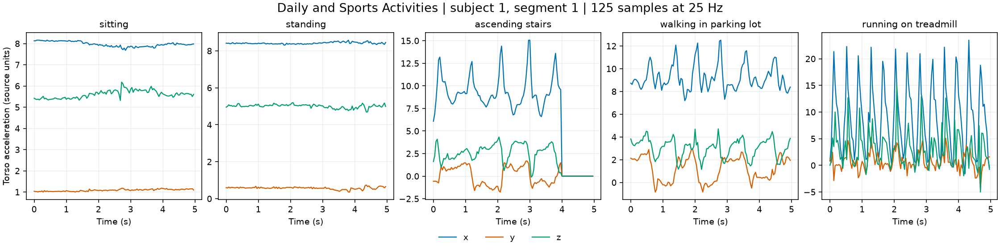

DailyAndSportsActivities
========================

   Five original windows from training subject 1, segment 1. Only torso
   acceleration x/y/z is shown (3 of 45 channels), without normalization.
   Each panel uses its own vertical scale.

Source and evaluation
---------------------

`Official UCI dataset <https://archive.ics.uci.edu/dataset/256/daily+and+sports+activities>`_ (CC BY 4.0).

This builder defines train as subjects 1–6 (6,840 windows) and test as subjects 7–8 (2,280 windows). UCI does not provide this train/test split. Keep subjects separate when creating validation folds.

Each sample contains ``series`` (time-major float32, shape ``(125, 45)``),
``label`` (zero-based activity index), and ``subject_id`` (original source ID).
Sampling rate is 25 Hz. No extra normalization or windowing is performed.
Class and channel order are exposed as ``CLASS_NAMES`` and ``CHANNEL_NAMES``.
The original ``segment_id`` is preserved. IDs are metadata, not classifier features.

Usage
-----

.. code-block:: python

    import numpy as np
    from stable_datasets.timeseries import DailyAndSportsActivities

    dataset = DailyAndSportsActivities()
    sample = dataset["train"][0]
    signal = np.asarray(sample["series"], dtype=np.float32)

The first call downloads the official archive and prepares both cached splits.
Later calls reuse the processed cache. Nested sequences can remain Python lists
under formatting; convert explicitly with NumPy or ``torch.as_tensor``.

Citation
--------

.. code-block:: bibtex

    @misc{daily_and_sports_activities_256,
      author = {Barshan, Billur and Altun, Kerem},
      title = {Daily and Sports Activities},
      year = {2010},
      publisher = {UCI Machine Learning Repository},
      doi = {10.24432/C5C59F},
      url = {https://doi.org/10.24432/C5C59F}
    }
