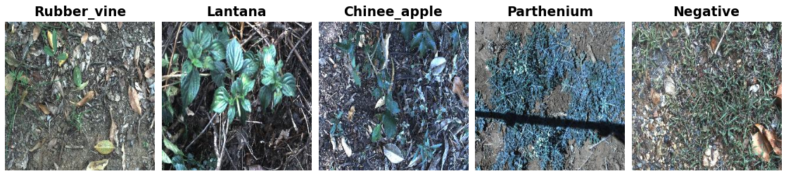

DeepWeeds
=========

.. raw:: html

   

   
   
   
   

Overview
--------

DeepWeeds contains 17,509 field images (256×256 RGB) of eight weed species native to Australia, photographed in situ among neighboring vegetation, plus a negative class of images without any of the target weeds. The images were collected at eight sites across Queensland: Black River, Charters Towers, Cluden, Douglas, Hervey Range, Kelso, McKinlay and Paluma.

The authors publish five official train/validation/test splits (about 60/20/20). Each is available as a builder variant, ``subset0`` to ``subset4``; ``subset0`` is the default.

- **Train** (``subset0``): 10,501 images
- **Validation** (``subset0``): 3,501 images
- **Test** (``subset0``): 3,507 images

Data Structure
--------------

When accessing an example using ``ds[i]``, you will receive a dictionary with the following keys:

.. list-table::
   :header-rows: 1
   :widths: 20 20 60

   * - Key
     - Type
     - Description
   * - ``image``
     - ``PIL.Image.Image``
     - 256×256 RGB field image
   * - ``label``
     - int
     - Class label (0-8)

Classes
-------

.. list-table::
   :header-rows: 1
   :widths: 15 40 45

   * - Label
     - Class Name
     - Images (all 17,509)
   * - 0
     - Chinee_apple
     - 1,125
   * - 1
     - Lantana
     - 1,064
   * - 2
     - Parkinsonia
     - 1,031
   * - 3
     - Parthenium
     - 1,022
   * - 4
     - Prickly_acacia
     - 1,062
   * - 5
     - Rubber_vine
     - 1,009
   * - 6
     - Siam_weed
     - 1,074
   * - 7
     - Snake_weed
     - 1,016
   * - 8
     - Negative
     - 9,106

The negative class makes up 52% of the images, so accuracy alone is a weak metric: always predicting ``Negative`` already scores about 52%. Report per-class or class-balanced metrics alongside it.

Usage Example
-------------

**Basic Usage**

.. code-block:: python

    from stable_datasets.images import DeepWeeds

    # Default variant (subset0)
    train_ds = DeepWeeds(split="train")
    val_ds = DeepWeeds(split="validation")
    test_ds = DeepWeeds(split="test")

    sample = train_ds[0]
    print(sample.keys())  # {"image", "label"}
    print(sample["image"].size)  # (256, 256)

    # Optional: make it PyTorch-friendly
    train_torch = train_ds.with_format("torch")

**Choosing an Official Split**

.. code-block:: python

    from stable_datasets.images import DeepWeeds

    # Variants subset0 ... subset4; results in the paper are averaged over all five
    ds = DeepWeeds(config_name="subset2", split="train")

**Getting Class Names**

.. code-block:: python

    from stable_datasets.images import DeepWeeds

    ds = DeepWeeds(split="train")
    class_names = ds.info.features["label"].names
    print(class_names[ds[0]["label"]])

Notes
-----

- **Image hosting**: the images archive is downloaded from the authors' Google Drive link.
- **Label and split files**: ``labels.csv`` and the 15 split files are downloaded as one archive of the authors' GitHub repository, pinned to commit ``da084f6``.
- **One label conflict in the source data**: image ``20170714-110407-3.jpg`` is labeled 1 (Lantana) in ``labels.csv`` but 0 (Chinee apple) in all five split files. The builder takes labels from ``labels.csv`` only and uses the split files for split membership, as TensorFlow Datasets does.

References
----------

- Homepage: https://github.com/AlexOlsen/DeepWeeds
- Paper: https://doi.org/10.1038/s41598-018-38343-3
- License: CC BY 4.0 (images and annotations)
- Published baseline: 95.7% average accuracy with an ImageNet-pretrained ResNet50, averaged over the five official splits

Citation
--------

.. code-block:: bibtex

    @article{DeepWeeds2019,
      author = {Alex Olsen and Dmitry A. Konovalov and Bronson Philippa and Peter Ridd and Jake C. Wood
                and Jamie Johns and Wesley Banks and Benjamin Girgenti and Owen Kenny and James Whinney
                and Brendan Calvert and Mostafa {Rahimi Azghadi} and Ronald D. White},
      title = {{DeepWeeds: A Multiclass Weed Species Image Dataset for Deep Learning}},
      journal = {Scientific Reports},
      year = {2019},
      volume = {9},
      number = {2058},
      doi = {10.1038/s41598-018-38343-3},
      url = {https://doi.org/10.1038/s41598-018-38343-3}
    }
