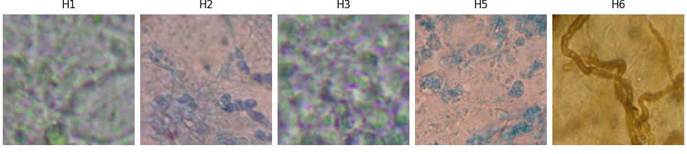

DeFungi
========

DeFungi contains 9,114 RGB microscopy patches in five classes. This builder
preserves the original JPEG bytes and class codes. It provides a custom,
deterministic split designed to keep related patches and exact byte duplicates
in the same partition.

Source
------

* Homepage: https://archive.ics.uci.edu/dataset/773/defungi
* Download: https://archive.ics.uci.edu/static/public/773/defungi.zip
* License: CC BY 4.0, as stated by UCI; distinct from the code license.
* Paper: https://doi.org/10.48550/arXiv.2109.07322
* ZIP SHA-256: ``02020311d1f8207f3aa3bf8b2303a5106463ac0bf35adde4ae042e8b2716ff6c``.

The paper describes cropping and filtering microscopy images into patches.
The UCI release contains only patches, without patient identifiers or an
official split. This integration is for image-classification research.

Classes and splits
------------------

.. list-table:: Counts for the pinned archive
   :header-rows: 1

   * - Label
     - Source code
     - Train
     - Validation
     - Test
     - Total
   * - 0
     - H1
     - 2976
     - 734
     - 694
     - 4404
   * - 1
     - H2
     - 1646
     - 377
     - 311
     - 2334
   * - 2
     - H3
     - 635
     - 50
     - 134
     - 819
   * - 3
     - H5
     - 574
     - 109
     - 135
     - 818
   * - 4
     - H6
     - 537
     - 83
     - 119
     - 739
   * - Total
     -
     - 6368
     - 1353
     - 1393
     - 9114

Filename-derived source groups use the class and numeric source identifier;
all letter variants and patch indices sharing that identifier stay together.
The archive has 447 such groups. Exact SHA-256 duplicate links join groups
transitively into 440 split groups. The archive contains 59 duplicate pairs,
of which 51 cross the initial source groups. All released images are retained,
with duplicates confined to a single split.

Within each class, components are ranked by SHA-256 of
``defungi-v1:42:<component>``. The first floor(70%) are training groups, the next
floor(15%) validation groups, and the remainder test groups, with at least one
group per partition. Image proportions differ because group sizes vary.
The resulting train/validation/test group counts are 306/64/70. This split is
independent of archive ordering, NumPy random-state versions and training seeds.

These are conservative filename-derived groups, not verified patient or slide
identities. Similar images with different provenance may still remain across
partitions. This custom protocol is not directly comparable to the paper's
reported scores. Class imbalance makes balanced accuracy and macro-F1 useful
alongside ordinary accuracy. The supplied labels are preserved without
reinterpreting them as species-level diagnoses.

Returned fields
---------------

* ``image``: decoded RGB PIL image, width 500 and height 500.
* ``label``: integer class id in the table above.
* ``image_id``: original archive member name.
* ``source_group``: class plus numeric source id, for example ``H1_100``.
* ``split_group``: canonical representative of a duplicate-linked component.

Usage
-----

Install this contribution's checkout with ``python -m pip install -e .``.
An older released package does not include this builder. A Windows script
uses a main guard because the shared downloader starts subprocesses:

.. code-block:: python

    from stable_datasets.images import DeFungi

    def main():
        data = DeFungi()
        print({name: len(split) for name, split in data.items()})
        sample = data["train"][0]
        print(sample["image"].size, sample["label"], sample["source_group"])

    if __name__ == "__main__":
        main()

``DeFungi(split="train")`` returns a single split. ``download_dir`` and
``processed_cache_dir`` control cache locations. The shared ZIP is downloaded
once and verified on a fresh download; subsequent loads reuse the Arrow cache.

Tests
-----

The integration test downloads the public archive through ``DeFungi`` into
fresh temporary directories. It checks exact split and class counts, fields
and label ranges, all 9,114 image decodes, unique image IDs, source-group and
linked-group separation, and that identical JPEG bytes never cross splits.
It also checks loading from the processed cache. No manual download or login
is required.

.. code-block:: text

    python -m pytest stable_datasets/tests/images/test_defungi.py -q

Citation
--------

.. code-block:: bibtex

    @misc{sopo2021defungi,
      title = {DeFungi: Direct Mycological Examination of Microscopic Fungi Images},
      author = {Pineda Sopo, Camilo Javier and Hajati, Farshid and Gheisari, Soheila},
      year = {2021},
      eprint = {2109.07322},
      archivePrefix = {arXiv},
      doi = {10.48550/arXiv.2109.07322}
    }
