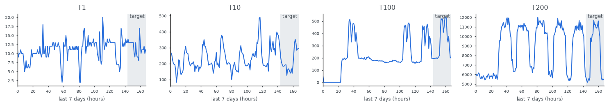

Electricity (Hourly)
====================

.. raw:: html

   

   
   
   
   

Overview
--------

Hourly electricity consumption (kW) of 321 clients from 2012 to 2014, as distributed by the Monash Time Series
Forecasting Archive (Godahewa et al., 2021). It is the hourly aggregate (Lai et al., 2017) of the UCI
ElectricityLoadDiagrams20112014 dataset. Every series has 26,304 points.

The splits follow the standard forecasting protocol used by Chronos and GluonTS:

- **Test**: the full series (321); the forecast target is the last ``PREDICTION_LENGTH = 24`` points.
- **Train**: the same series without those last 24 points.

``ElectricityHourly.FREQ`` (``"h"``), ``PREDICTION_LENGTH`` (24) and ``SEASONALITY`` (24, used to scale MASE)
describe the protocol.

Data Structure
--------------

.. list-table::
   :header-rows: 1
   :widths: 20 20 60

   * - Key
     - Type
     - Description
   * - ``series``
     - list of float32
     - Hourly consumption in kW
   * - ``item_id``
     - str
     - Client id from the Monash file (``T1`` ... ``T321``)
   * - ``start``
     - str
     - ISO timestamp of the first point, as given by Monash (``2012-01-01T00:00:01``)

Usage Example
-------------

.. code-block:: python

    import numpy as np
    from stable_datasets.timeseries import ElectricityHourly

    test = ElectricityHourly(split="test")
    H = ElectricityHourly.PREDICTION_LENGTH
    y = np.asarray(test[0]["series"])
    context, target = y[:-H], y[-H:]

References
----------

- Homepage: https://zenodo.org/records/4656140
- Original data: https://archive.ics.uci.edu/dataset/321/electricityloaddiagrams20112014
- License: CC BY 4.0

Citation
--------

.. code-block:: bibtex

    @inproceedings{godahewa2021monash,
      title={Monash Time Series Forecasting Archive},
      author={Godahewa, Rakshitha and Bergmeir, Christoph and Webb, Geoffrey I. and Hyndman, Rob J. and Montero-Manso, Pablo},
      booktitle={Neural Information Processing Systems Track on Datasets and Benchmarks},
      year={2021}
    }
