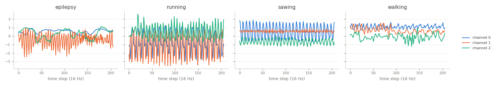

Epilepsy
========

.. raw:: html

   

   
   
   
   
   

Overview
--------

Multivariate time series classification dataset from the UEA archive (Bagnall et al., 2018), based on the data of
Villar et al. (2016). Six healthy participants wore a tri-axial accelerometer on the dominant wrist, sampled at 16 Hz,
while performing four activities: a mimicked epileptic seizure (trained and controlled following a protocol defined
by a medical expert), walking, running and sawing.

The archive removed flat prefixes and suffixes, truncated every recording to the length of the shortest one, 206
steps (about 13 seconds), and dropped one recording that was not collected correctly. The loader passes the archive's
data through unchanged.

- **Train**: 137 recordings from three participants.
- **Test**: 138 recordings from the other three participants.

Class names are the archive's labels in lower case: ``epilepsy``, ``running``, ``sawing``, ``walking``.

Data Structure
--------------

.. list-table::
   :header-rows: 1
   :widths: 20 20 60

   * - Key
     - Type
     - Description
   * - ``series``
     - list of list of float32
     - Accelerometer recording, shape ``(206, 3)``: time steps by channels
   * - ``label``
     - int
     - Activity class (0-3)

Usage Example
-------------

.. code-block:: python

    import numpy as np
    from stable_datasets.timeseries import Epilepsy

    train = Epilepsy(split="train")
    sample = train[0]
    x = np.asarray(sample["series"])  # (206, 3)
    print(x.shape, train.features["label"].names[sample["label"]])

References
----------

- Homepage: https://timeseriesclassification.com/description.php?Dataset=Epilepsy
- Archive record: https://doi.org/10.5281/zenodo.11206204
- Original data: http://di002.edv.uniovi.es/~villar/Jose_R._Villar/Public_Data_sets/Entries/2016/5/3_Seizure_simulation_raw_data.html
- License: CC BY 4.0

Citation
--------

.. code-block:: bibtex

    @article{villar2016generalized,
      title={Generalized Models for the Classification of Abnormal Movements in Daily Life and its Applicability to Epilepsy Convulsion Recognition},
      author={Villar, José R. and Vergara, Paula and Menéndez, Manuel and de la Cal, Enrique and González, Víctor M. and Sedano, Javier},
      journal={International Journal of Neural Systems},
      volume={26},
      number={6},
      pages={1650037},
      year={2016}
    }

    @article{bagnall2018uea,
      title={The UEA multivariate time series classification archive, 2018},
      author={Bagnall, Anthony and Dau, Hoang Anh and Lines, Jason and Flynn, Michael and Large, James and Bostrom, Aaron and Southam, Paul and Keogh, Eamonn},
      journal={arXiv preprint arXiv:1811.00075},
      year={2018}
    }
