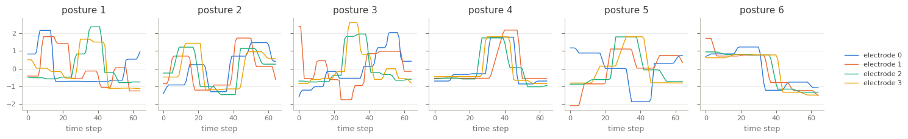

ERing
=====

.. raw:: html

   

   
   
   
   
   

Overview
--------

Multivariate time series classification dataset from the UEA archive (Bagnall et al., 2018), recorded with
eRing, a prototype finger ring that detects hand and finger gestures with electric field sensing (Wilhelm et
al., 2015). Each recording holds the measurements of 4 electrodes, which vary with the distance to the hand,
over 65 steps. The six classes are postures of the thumb, index and middle finger.

The training set is very small (5 recordings per class), the test set much larger. The loader passes the
archive's data through unchanged.

- **Train**: 30 recordings (5 per class).
- **Test**: 270 recordings (45 per class).

The archive labels the postures ``1`` to ``6`` without naming them, so the class names are the numbers ``1``
to ``6``.

Data Structure
--------------

.. list-table::
   :header-rows: 1
   :widths: 20 20 60

   * - Key
     - Type
     - Description
   * - ``series``
     - list of list of float32
     - Electrode measurements, shape ``(65, 4)``: time steps by channels
   * - ``label``
     - int
     - Posture class (0-5)

Usage Example
-------------

.. code-block:: python

    import numpy as np
    from stable_datasets.timeseries import ERing

    train = ERing(split="train")
    sample = train[0]
    x = np.asarray(sample["series"])  # (65, 4)
    print(x.shape, train.features["label"].names[sample["label"]])

References
----------

- Homepage: https://timeseriesclassification.com/description.php?Dataset=ERing
- Archive record: https://doi.org/10.5281/zenodo.11206210
- Original paper: https://doi.org/10.1145/2790044.2790047
- License: CC BY 4.0

Citation
--------

.. code-block:: bibtex

    @inproceedings{wilhelm2015ering,
      title={eRing: Multiple Finger Gesture Recognition with one Ring Using an Electric Field},
      author={Wilhelm, Mathias and Krakowczyk, Daniel and Trollmann, Frank and Albayrak, Sahin},
      booktitle={Proceedings of the 2nd International Workshop on Sensor-based Activity Recognition and Interaction},
      pages={1--6},
      year={2015}
    }

    @article{bagnall2018uea,
      title={The UEA multivariate time series classification archive, 2018},
      author={Bagnall, Anthony and Dau, Hoang Anh and Lines, Jason and Flynn, Michael and Large, James and Bostrom, Aaron and Southam, Paul and Keogh, Eamonn},
      journal={arXiv preprint arXiv:1811.00075},
      year={2018}
    }
