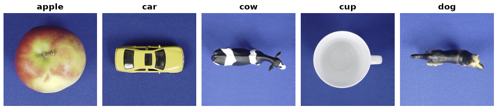

ETH-80
======

Overview
--------

``ETH80`` loads the original **cropped256** release: 3,280 RGB images,
eight object categories, ten physical objects per category, and 41 views per
object. Images have shape 256 x 256. Segmentation maps are excluded.

   Five training examples from the ETH-80 cropped256 release by Leibe and
   Schiele (2003), hosted by the Max Planck Institute for Informatics.
   The preview uses the original image colors and labels. See `Source and terms`_
   for the provider link and reuse information.

The archive is downloaded from the Max Planck Institute's dataset server and
checked against a SHA-256 digest measured from that release. Its source
page describes cropped256 as the standard set with a 20% border and a
consistent scale across views of each object.

Instance-disjoint partitions
----------------------------

These are **custom partitions defined by this loader**, not official partitions
from the original paper. Within each category, the original numeric instance IDs
are sorted: the first six objects form the training set, the next two the
validation set, and the last two the test set. Every view of an object stays in the same partition.

.. list-table::
   :header-rows: 1

   * - Split
     - Objects
     - Images
     - Images per class
   * - ``train``
     - 48
     - 1,968
     - 246
   * - ``validation``
     - 16
     - 656
     - 82
   * - ``test``
     - 16
     - 656
     - 82

Most categories have IDs 1 through 10. **Cars have IDs
1, 2, 3, 5, 6, 7, 9, 11, 12, 14.** Their training IDs are 1, 2, 3, 5, 6, 7;
validation IDs are 9, 11; test IDs are 12, 14. Original IDs are preserved.
Do not apply a random image-level split when evaluating unseen objects.

Fields and labels
-----------------

* ``image``: decoded RGB PIL image; a float32 CHW tensor in ``with_format("torch")``.
* ``label``: integer in the fixed order ``apple, car, cow, cup, dog, horse, pear, tomato``.
* ``object_id``: globally unique string, for example ``car14``.
* ``instance_id``: original numeric ID within the category, for example ``14``.
* ``view_id``: original two-component viewpoint token, for example ``090-045``.
* ``image_id``: original filename, for example ``car14-090-045.png``.

Usage
-----

.. code-block:: python

    from torch.utils.data import DataLoader
    from stable_datasets.images import ETH80

    data = ETH80(
        download_dir="./data/downloads",
        processed_cache_dir="./data/processed",
    )
    batch = next(iter(DataLoader(data["train"].with_format("torch"), batch_size=8)))
    assert batch["image"].shape == (8, 3, 256, 256)

The standard builder handles download locking, Arrow cache writing and reopening.
The archive parser validates all 80 objects and 41 images per object, rejects
malformed or duplicate image names, and reads members without extracting paths
onto the filesystem. Access-time preprocessing can use ``with_transform``.

Source and terms
----------------

* `Provider page <https://www.mpi-inf.mpg.de/departments/computer-vision-and-machine-learning/research/object-recognition-and-scene-understanding/analyzing-appearance-and-contour-based-methods-for-object-categorization>`_
* `cropped256 archive <https://datasets.d2.mpi-inf.mpg.de/eth80/eth80-cropped256.tgz>`_
* Release SHA-256: ``3552a8199bbf011bcc795364496430dbf936816f89b96ddb7a28af67cc6e6c95``.

No explicit dataset license was found on the provider page or in the downloaded
archive during verification. The library's software license does not grant rights to
the source images. Reuse terms are determined by the original provider.
The repository includes loader code, synthetic test fixtures, and the five attributed preview
images above. The full source image archive is not included; the preview images
remain subject to the original provider's terms.

Citation
--------

.. code-block:: bibtex

    @inproceedings{leibe2003analyzing,
      title={Analyzing Appearance and Contour Based Methods for Object Categorization},
      author={Leibe, Bastian and Schiele, Bernt},
      booktitle={IEEE Conference on Computer Vision and Pattern Recognition},
      year={2003}
    }

Validation
----------

See ``examples/validate_object_datasets.py`` for full source-pixel, split, cache,
and batch checks. ``examples/object_datasets_lejepa.py`` provides the small SSL
experiment; its protocol and limitations are in ``docs/object-datasets-validation.md``.
