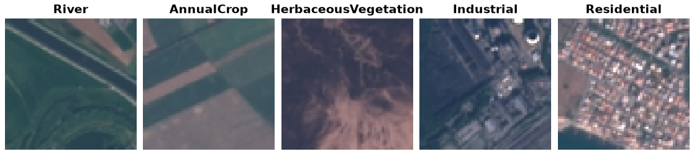

EuroSAT
=======

.. raw:: html

   

   
   
   
   

Overview
--------

EuroSAT is a land use / land cover classification dataset built from
Sentinel-2 satellite imagery, covering 10 classes with 27,000 labeled
64x64 RGB images in total.

- **Train**: all 27,000 images (no official split ships with the archive)

There is no official train/val/test split, so this builder exposes the
full dataset as a single ``train`` split (the same handling used for
AWA2). Hold out your own validation set if you need one.

Data Structure
--------------

When accessing an example using ``ds[i]``, you will receive a dictionary
with the following keys:

.. list-table::
   :header-rows: 1
   :widths: 20 20 60

   * - Key
     - Type
     - Description
   * - ``image``
     - ``PIL.Image.Image``
     - RGB image, 64x64
   * - ``label``
     - int
     - Land use / land cover class (0-9)

Classes
-------

AnnualCrop, Forest, HerbaceousVegetation, Highway, Industrial, Pasture,
PermanentCrop, Residential, River, SeaLake

Usage Example
--------------

.. code-block:: python

    from stable_datasets.images.eurosat import EuroSAT

    ds = EuroSAT(split="train")

    sample = ds[0]
    print(sample.keys())  # {"image", "label"}

    class_names = ds.info.features["label"].names
    print(class_names[sample["label"]])

    # Optional: make it PyTorch-friendly
    ds_torch = ds.with_format("torch")

References
----------

- Official website: https://github.com/phelber/EuroSAT
- License: MIT License (Sentinel-2 imagery is also subject to the Copernicus Sentinel Data Terms and Conditions)
- Paper: EuroSAT: A Novel Dataset and Deep Learning Benchmark for Land Use and Land Cover Classification (IEEE JSTARS 2019)

Citation
--------

.. code-block:: bibtex

    @article{helber2019eurosat,
      title={EuroSAT: A Novel Dataset and Deep Learning Benchmark for Land Use and Land Cover Classification},
      author={Helber, Patrick and Bischke, Benjamin and Dengel, Andreas and Borth, Damian},
      journal={IEEE Journal of Selected Topics in Applied Earth Observations and Remote Sensing},
      year={2019}
    }
