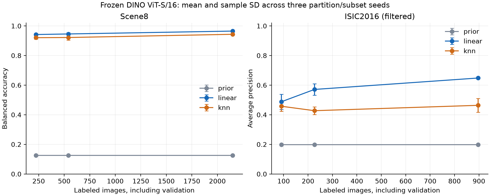
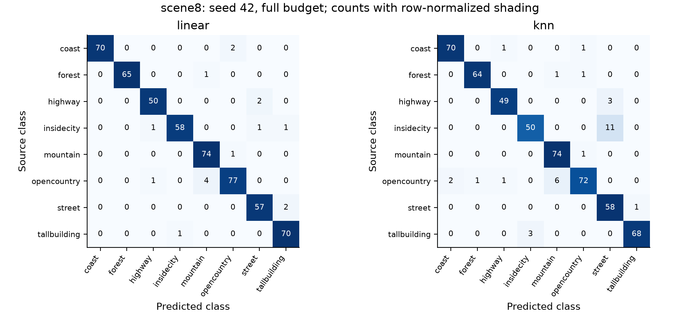
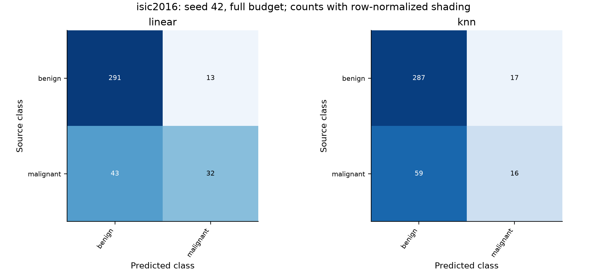

# Supplementary Verification: Scene8 and ISIC2016

## Contribution and verified execution

Two native builders preserve original JPEG bytes, labels, stable IDs, and source memberships. A complete audit decoded 3,967 images and found exact duplicates, including a Scene8 label conflict and three ISIC train/test duplicate pairs. The primary ISIC protocol excludes the three training duplicates; its official companion shares validation and restores them only for the declared full-budget comparison.

The locked matrix contains 42 learned-model conditions and 18 prior baselines. Every saved prediction payload was checksum-verified and every reported metric recomputed. Raw images and pretrained weights are not distributed with these results.

## Evaluation

The original ImageNet-1K DINO ViT-S/16 remains frozen. Both probes use the same 384-dimensional final-block CLS features and deterministic 224-pixel center crops. The linear probe selects C from [0.1, 1, 10]; weighted cosine kNN selects k from [5, 10, 20] at temperature 0.07. Selection uses balanced accuracy for Scene8 and AP for ISIC. AP uses scikit-learn's definition, not trapezoidal PR-AUC.

Nominal 10%, 25%, and 100% subsets preserve exact-pixel groups and are nested within each role. Validation labels count toward each budget. Hyperparameters are selected on the permitted fitting/validation subsets, and final classifiers refit on only their union. ISIC uses a fixed 0.5 decision threshold. The official companion reuses the filtered full-budget hyperparameter without retuning.

## Results

Values are mean +/- sample SD across seeds 42, 43, and 44. Seed variation concerns partitions/subsets; the pretrained encoder is identical. These SDs are not confidence intervals.

| Dataset/protocol | Nominal fraction | Method | Labeled images | Primary metric | Top-1 accuracy |
| --- | ---: | --- | ---: | ---: | ---: |
| isic2016/official companion | 100% | knn | 900-900 | 0.4765 +/- 0.0434 | 0.8100 +/- 0.0115 |
| isic2016/official companion | 100% | linear | 900-900 | 0.6504 +/- 0.0000 | 0.8522 +/- 0.0000 |
| isic2016/filtered | 10% | knn | 91-91 | 0.4573 +/- 0.0334 | 0.8127 +/- 0.0026 |
| isic2016/filtered | 10% | linear | 91-91 | 0.4878 +/- 0.0512 | 0.8109 +/- 0.0152 |
| isic2016/filtered | 10% | prior | 91-91 | 0.1979 +/- 0.0000 | 0.8021 +/- 0.0000 |
| isic2016/filtered | 25% | knn | 226-227 | 0.4274 +/- 0.0265 | 0.8012 +/- 0.0110 |
| isic2016/filtered | 25% | linear | 226-227 | 0.5709 +/- 0.0388 | 0.8241 +/- 0.0202 |
| isic2016/filtered | 25% | prior | 226-227 | 0.1979 +/- 0.0000 | 0.8021 +/- 0.0000 |
| isic2016/filtered | 100% | knn | 897-897 | 0.4636 +/- 0.0470 | 0.8047 +/- 0.0115 |
| isic2016/filtered | 100% | linear | 897-897 | 0.6481 +/- 0.0000 | 0.8522 +/- 0.0000 |
| isic2016/filtered | 100% | prior | 897-897 | 0.1979 +/- 0.0000 | 0.8021 +/- 0.0000 |
| scene8/grouped | 10% | knn | 223-223 | 0.9205 +/- 0.0096 | 0.9164 +/- 0.0067 |
| scene8/grouped | 10% | linear | 223-223 | 0.9417 +/- 0.0074 | 0.9405 +/- 0.0067 |
| scene8/grouped | 10% | prior | 223-223 | 0.1250 +/- 0.0000 | 0.1524 +/- 0.0000 |
| scene8/grouped | 25% | knn | 541-543 | 0.9216 +/- 0.0170 | 0.9188 +/- 0.0142 |
| scene8/grouped | 25% | linear | 541-543 | 0.9456 +/- 0.0092 | 0.9449 +/- 0.0084 |
| scene8/grouped | 25% | prior | 541-543 | 0.1250 +/- 0.0000 | 0.1524 +/- 0.0000 |
| scene8/grouped | 100% | knn | 2150-2150 | 0.9434 +/- 0.0051 | 0.9405 +/- 0.0049 |
| scene8/grouped | 100% | linear | 2150-2150 | 0.9650 +/- 0.0072 | 0.9647 +/- 0.0064 |
| scene8/grouped | 100% | prior | 2150-2150 | 0.1250 +/- 0.0000 | 0.1524 +/- 0.0000 |

## Findings and error analysis

The linear classifier's mean primary score increases with the label budget on both tasks in this declared experiment. kNN does not improve monotonically on ISIC, so more labeled examples do not guarantee improvement for every fixed-feature classifier/selection protocol. These observations do not isolate a causal effect of domain or establish a general algorithm ranking.

The three full-budget ISIC linear runs refit on the same 897-image pool after selecting the same C. Their deterministic predictions coincide, explaining the zero seed SD. This is not evidence from three independently pretrained encoders or three independent test sets. kNN can differ because the inner partitions select different neighbor counts.

`errors_seed42.csv` contains every error from the full-budget primary linear/kNN runs at seed 42, ranked by predicted-class probability within each dataset/method. This explicit rule avoids selecting only visually convenient failures. Image IDs link back to the original data without redistributing photographs.

At the fixed 0.5 threshold, the seed-42 ISIC linear classifier correctly identifies 32 of 75 malignant examples and misses 43; it produces 13 false positives. Its relatively high overall accuracy therefore must not be interpreted as high malignant sensitivity. AP measures ranking across thresholds, while this confusion matrix describes the predeclared single threshold.

## Uncertainty and limitations

The companion `uncertainty.json` reports seed-42 full-budget conditional percentile intervals from 2,000 stratified exact-pixel-group bootstrap draws. Paired differences share draws. These intervals exclude patient, partition, training, and pretraining uncertainty. Scene8 test sets overlap across seeds; ISIC reuses its 379-image official test set. Neither supports treating seed runs as independent samples from a population of trained encoders.

The smallest ISIC validation subset is small, so hyperparameter selection is noisy. Pixel duplicates do not establish patient independence or rule out near-duplicates and ImageNet overlap. Filtering uses test pixels in a disclosed transductive audit, not diagnoses or scores. The Scene8 conflicting labels are retained. Center cropping can discard peripheral scene or lesion information. These are transfer-validation results, not clinical validation or target-dataset DINO pretraining.

## Reproduction and evidence

Run the source checkout commands in `benchmarks/transfer/SCENE8_ISIC2016_README.md`. `runs.csv` contains every condition and parameter; `summary.csv` contains aggregates; `predictions.csv.gz` contains every test ID, target, and class probability. `evidence.json` binds these files to feature caches, code, weights, manifests, and software versions. `matrix.json.gz` additionally retains every selected subset and validation candidate score.

A known-method optimization smoke test is recorded separately and must not be interpreted as converged representation learning. Course acceptance of frozen transfer versus complete target-data SSL pretraining still depends on the instructor's interpretation.
