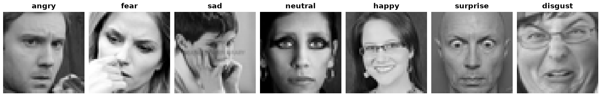

FER2013
=======

.. raw:: html

   

   
   
   
   

Overview
--------
FER2013 (Facial Expression Recognition 2013) contains 48×48 grayscale face crops, each labelled with one of seven
facial expressions: angry, disgust, fear, happy, sad, surprise and neutral. It was released for the ICML 2013
"Challenges in Representation Learning" Kaggle competition and is one of the datasets of CLIP's linear-probe
evaluation suite. The faces were found with web image searches and cropped automatically, so pose, lighting, age and
occlusion vary widely; human accuracy is estimated at about 65%, and the classes are imbalanced (``disgust`` has 547
images, ``happy`` 8,989).

The competition's ``Usage`` column defines the splits:

- **Train**: 28,709 images (``Training``)
- **Validation**: 3,589 images (``PublicTest``)
- **Test**: 3,589 images (``PrivateTest``)

Download
--------
Kaggle requires an account and acceptance of the competition rules, so FER2013 cannot be downloaded automatically.
Download ``fer2013.csv`` (or ``fer2013.tar.gz`` / ``icml_face_data.csv``) from the
`competition data page <https://www.kaggle.com/c/challenges-in-representation-learning-facial-expression-recognition-challenge/data>`_
and place it in the download directory (``download_dir``, by default ``~/.stable-datasets/downloads/``, or
``$STABLE_DATASETS_CACHE_DIR/downloads/``). The builder verifies the file's MD5 checksum before using it.

Data Structure
--------------

When accessing an example using ``ds[i]``, you will receive a dictionary with the following keys:

.. list-table::
   :header-rows: 1
   :widths: 20 20 60

   * - Key
     - Type
     - Description
   * - ``image``
     - ``PIL.Image.Image``
     - 48×48 grayscale face
   * - ``label``
     - int
     - 0: angry, 1: disgust, 2: fear, 3: happy, 4: sad, 5: surprise, 6: neutral

Usage Example
-------------

.. code-block:: python

    from stable_datasets.images import FER2013

    # Requires fer2013.csv in the download directory (see "Download" above).
    ds = FER2013(split="train")
    ds_all = FER2013(split=None)  # train / validation / test

    sample = ds[0]
    print(sample.keys())  # {"image", "label"}

    ds_torch = ds.with_format("torch")

References
----------

- Official website: https://www.kaggle.com/c/challenges-in-representation-learning-facial-expression-recognition-challenge
- License: Kaggle competition rules

Citation
--------

.. code-block:: bibtex

    @inproceedings{goodfellow2013challenges,
        title={Challenges in Representation Learning: A report on three machine learning contests},
        author={Goodfellow, Ian J. and Erhan, Dumitru and Carrier, Pierre Luc and Courville, Aaron and
                Mirza, Mehdi and Hamner, Ben and Cukierski, Will and Tang, Yichuan and Thaler, David and
                Lee, Dong-Hyun and others},
        booktitle={International Conference on Neural Information Processing (ICONIP)},
        year={2013}}
