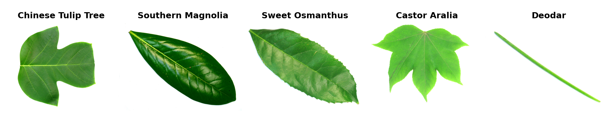

Flavia
======

.. raw:: html

   

   
   
   
   

Overview
--------

Flavia contains 1,907 leaf photographs from 32 plant species. This builder loads
the complete raw image collection from ``Leaves.tar.bz2``, not the smaller
standard-leaf library distributed with the recognition software. Images are
returned in RGB at their original resolution, without resizing.

- **Train**: 1,907 images, comprising the complete collection.
- **Test/validation**: No fixed official partitions are distributed. Create
  downstream evaluation splits explicitly; ``train`` does not denote a published
  training partition.

Data Structure
--------------

Each example is a dictionary with these keys:

.. list-table::
   :header-rows: 1
   :widths: 20 20 60

   * - Key
     - Type
     - Description
   * - ``image``
     - ``PIL.Image.Image``
     - HxWx3 RGB leaf image at its original resolution
   * - ``label``
     - int
     - Plant-species label (0-31)

Labels preserve the official website's class-table order. Published labels 1-12
map to 0-11, and labels 14-33 map to 12-31; the original table omits label 13.
Common names use lowercase with underscores for spaces. Filename ranges determine
the labels, not filename sorting: ``1552.jpg`` is ``anhui_barberry`` (2), whereas
``1123.jpg`` is ``chinese_redbud`` (3).

Usage Example
-------------

.. code-block:: python

    from stable_datasets.images import Flavia

    # Download the original archive and prepare the local Arrow cache.
    ds = Flavia(split="train")
    sample = ds[0]
    print(sample.keys())  # {"image", "label"}
    print(ds.features["label"].int2str(sample["label"]))

    # The full dataset dictionary contains only "train".
    ds_all = Flavia(split=None)

    # An optional downstream split, not an official Flavia benchmark partition.
    partitions = ds.train_test_split(test_size=0.2, seed=42)

References
----------

- `Official website and class-to-filename table <https://flavia.sourceforge.net/>`_
- `Complete raw dataset <https://sourceforge.net/projects/flavia/files/Leaf%20Image%20Dataset/1.0/Leaves.tar.bz2/download>`_
  (approximately 966 MB compressed; published MD5: ``8d3ca661e201f4eac8d0975e7b6b5853``).
- `Original paper <https://arxiv.org/abs/0707.4289>`_
- **License**: The website does not specify a separate image-data license. Its
  GPL notice describes the MATLAB program; this builder does not assign that
  software license to the images. The authors request citation of their paper.

The teaser uses original archive members ``Leaves/3529.jpg``, ``Leaves/3411.jpg``,
``Leaves/2339.jpg``, ``Leaves/1389.jpg``, and ``Leaves/2423.jpg``. Regenerate it from
the raw archive with
``PYTHONPATH=. MPLBACKEND=Agg python docs/source/datasets/teasers/generate_flavia_teaser.py --archive /path/to/Leaves.tar.bz2``.

Citation
--------

.. code-block:: bibtex

    @inproceedings{wu2007flavia,
      author    = {Stephen Gang Wu and Forrest Sheng Bao and Eric You Xu and
                   Yu-Xuan Wang and Yi-Fan Chang and Qiao-Liang Xiang},
      title     = {A Leaf Recognition Algorithm for Plant Classification Using Probabilistic Neural Network},
      booktitle = {2007 IEEE International Symposium on Signal Processing and Information Technology},
      year      = {2007},
      doi       = {10.1109/ISSPIT.2007.4458016}
    }
