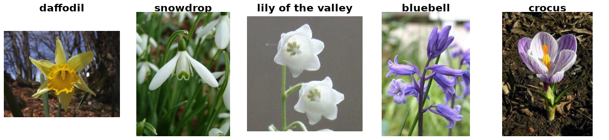

Flowers17
=========

Overview
--------

Oxford Flowers-17 contains 1,360 images of 17 flower categories, with 80 images
per category. This builder supports classification using the original images
and all three official partitions from ``datasplits.mat``.

Choose ``partition1`` (the default), ``partition2``, or ``partition3`` with
``config_name``. Each partition contains:

- **Train**: 680 images (40 per class)
- **Validation**: 340 images (20 per class)
- **Test**: 340 images (20 per class)

Within a partition, the three splits are disjoint and cover all 1,360 images.
The partitions are alternative assignments of the same images, so images may
appear in different splits across partitions. The original paper reports results
averaged over the three partitions; a single-partition result is not that protocol.

Data Structure
--------------

Each example contains:

.. list-table::
   :header-rows: 1
   :widths: 20 20 60

   * - Key
     - Type
     - Description
   * - ``image``
     - ``PIL.Image.Image``
     - Variable-resolution RGB flower image
   * - ``label``
     - int
     - Class label from 0 to 16

Image filenames contain one-based IDs. Consecutive blocks of 80 IDs belong to
one class, giving the zero-based label ``(image_id - 1) // 80``. Class order is:
daffodil, snowdrop, lily of the valley, bluebell, crocus, iris, tiger lily, tulip,
fritillary, sunflower, daisy, colt's foot, dandelion, cowslip, buttercup,
windflower, pansy.

Split membership comes from the selected partition's ``trn``, ``val``, and
``tst`` arrays in ``datasplits.mat``. The archive's filename lists are ignored.
Segmentation annotations are outside this builder's scope.

Usage Example
-------------

.. code-block:: python

    from stable_datasets.images import Flowers17

    train = Flowers17(config_name="partition1", split="train")
    validation = Flowers17(config_name="partition1", split="validation")
    test = Flowers17(config_name="partition1", split="test")

    # Omitting split returns all three splits of the selected partition.
    partition2 = Flowers17(config_name="partition2")
    sample = partition2["train"][0]
    print(sample["label"])

The first load downloads the image archive and split file and prepares the
selected partition's processed cache. Raw downloads are shared across partitions;
processed caches are separate for each partition and split. Subsequent loads
reuse those caches.

References
----------

- `Official dataset <https://www.robots.ox.ac.uk/~vgg/data/flowers/17/>`_
- `Dataset README <https://www.robots.ox.ac.uk/~vgg/data/flowers/17/README.txt>`_
- `Original publication <https://www.robots.ox.ac.uk/~vgg/publications/2006/Nilsback06/>`_

Citation
--------

.. code-block:: bibtex

    @InProceedings{Nilsback06,
      author = {Maria-Elena Nilsback and Andrew Zisserman},
      title = {A Visual Vocabulary for Flower Classification},
      booktitle = {IEEE Conference on Computer Vision and Pattern Recognition},
      volume = {2},
      pages = {1447--1454},
      year = {2006},
    }
