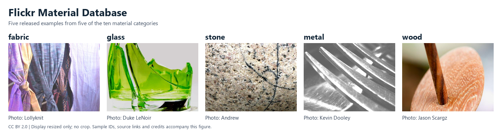

FMD
===

   Five released samples, resized without cropping and arranged for display.
   Source photographs and credits are listed under :ref:`fmd-teaser-credits`.

Source and Scale
----------------

The `Flickr Material Database (FMD)
<https://people.csail.mit.edu/lavanya/fmd.html>`_ contains 1,000 photographs in
ten material categories, with 100 photographs per category: 50 close-ups and
50 regular views. Each photograph has a region-of-interest mask. The released
photo/mask pairs are 512 by 384 pixels.

The `official ZIP <https://people.csail.mit.edu/celiu/CVPR2010/FMD/FMD.zip>`_
is 58,627,619 bytes. Photos use ``image/<class>/<filename>.jpg``; their masks
have the same relative names below ``mask/``. Metadata files are not samples.
The builder pins the archive SHA-256
``254475ddb37bf0fe1383ff9ea61eb71042db33af1f9a9aa8747391a72135b8f8``.
This fingerprint was computed from the downloaded release; it is not a
checksum published by the dataset authors.

Schema and Collection
---------------------

``FMD`` uses ``supervised_keys=("image", "label")``. Each sample contains:

- ``image``: an ``Image`` feature, returned as an RGB PIL image by default.
- ``label``: a ``ClassLabel`` integer in the fixed order ``fabric``,
  ``foliage``, ``glass``, ``leather``, ``metal``, ``paper``, ``plastic``,
  ``stone``, ``water``, ``wood``.
- ``image_id``: the unique category-relative path ``<class>/<filename>.jpg``.
- ``mask``: an ``Image`` feature, returned as an L or RGB PIL image with the
  same dimensions as its photograph.

``FMD()`` and ``FMD(split=None)`` return a ``StableDatasetDict`` containing
only ``train``. ``FMD(split="train")`` returns that ``StableDataset`` with
all 1,000 records. Here ``train`` names the complete collection; the archive
has no fixed official training, validation or test partition. Close-up versus
regular view does not define a partition. The builder does not resize or
normalize samples or assign experimental splits.

Mask Preservation
-----------------

Released JPEG masks can be L or RGB, have nonbinary values, and have unequal
RGB channels. The builder preserves each mask's original decoded mode,
dimensions and pixels as lossless PNG. It does not grayscale, threshold,
merge channels, resize or encode masks as JPEG again. This preserves decoded
pixels, rather than the original compressed JPEG bytes. Photographs are also
stored as PNG after RGB decoding.

With ``with_format("numpy")``, images are H x W x 3 uint8 arrays and masks are
H x W or H x W x 3 uint8 arrays. The torch formatter returns CHW float tensors
divided by 255. Mixed-mode masks therefore have different channel counts;
classification code should select only ``image`` and ``label`` before batching
and pass only images to the model.

Loading and Cache
-----------------

The first load downloads the public archive and prepares the native cache.
Use explicit cache locations when needed:

.. code-block:: python

   from stable_datasets.images import FMD

   options = dict(
       download_dir="/your/data/downloads",
       processed_cache_dir="/your/data/processed",
   )
   collections = FMD(**options)
   assert set(collections) == {"train"}
   dataset = FMD(split="train", **options)
   sample = dataset[0]
   assert sample["image"].mode == "RGB"
   assert sample["mask"].mode in {"L", "RGB"}
   assert sample["image"].size == sample["mask"].size

Archive members are read without filesystem extraction. Missing or orphaned
masks, duplicate or unsafe member names, corrupt images, unsupported mask
modes and mismatched dimensions raise errors. Subsequent loads reuse the
processed cache. ``with_format("raw")`` exposes the encoded PNG bytes;
changing a formatter does not alter the cached annotations.

License and Citation
--------------------

The source page lists Creative Commons terms, image credits and exceptions
with different licenses. Consult the source gallery and original photograph
attributions; the archive does not provide a per-image license mapping, and
this contribution does not assert one uniform dataset license. The repository
includes only the five reduced-size photograph previews credited below, not
the dataset archive, full-resolution photographs or masks.

.. _fmd-teaser-credits:

Teaser Credits
~~~~~~~~~~~~~~

The teaser uses the first displayed example in each of five categories from
the `official gallery <https://people.csail.mit.edu/lavanya/fmd.html>`_. That
page identifies these photographs as
`CC BY 2.0 <https://creativecommons.org/licenses/by/2.0/>`_. Its stated Foliage
exceptions do not concern these five images. Filenames identify the released
ZIP samples; links identify the matching gallery photographs. The archive
and gallery JPEGs are not byte-identical. The teaser uses the verified archive
samples with aspect-ratio-preserving resizing, padding and labels; no cropping
or model preprocessing was applied.

.. list-table:: Photograph credits, from left to right
   :header-rows: 1
   :widths: 70 30

   * - Released image ID / gallery photograph
     - Photographer credited by FMD
   * - `fabric/fabric_moderate_014_new.jpg <https://people.csail.mit.edu/lavanya/images/fmd/fabric/fabric_moderate_014_new.jpg>`_
     - Lollyknit
   * - `glass/glass_moderate_005_new.jpg <https://people.csail.mit.edu/lavanya/images/fmd/glass/glass_moderate_005_new.jpg>`_
     - Duke LeNoir
   * - `stone/stone_moderate_010_new.jpg <https://people.csail.mit.edu/lavanya/images/fmd/stone/stone_moderate_010_new.jpg>`_
     - Andrew
   * - `metal/metal_moderate_020_new.jpg <https://people.csail.mit.edu/lavanya/images/fmd/metal/metal_moderate_020_new.jpg>`_
     - Kevin Dooley
   * - `wood/wood_moderate_003_new.jpg <https://people.csail.mit.edu/lavanya/images/fmd/wood/wood_moderate_003_new.jpg>`_
     - Jason Scargz

Photographer names follow the gallery; no unverified profile URLs are supplied.

Reference: L. Sharan, R. Rosenholtz, and E. H. Adelson, *Accuracy and speed of
material categorization in real-world images*, Journal of Vision 14(9),
article 12, 2014, `doi:10.1167/14.9.12 <https://doi.org/10.1167/14.9.12>`_.
