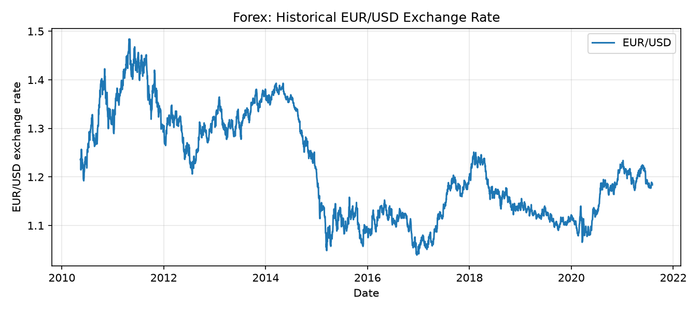

Foreign Exchange Rates (Forex)
==============================

Overview
--------

The Forex dataset contains historical daily EUR/USD exchange-rate
observations sourced from the Yllvar/fx-historical-data dataset
on Hugging Face.

Each example represents one daily observation with raw OHLCV values.
No rolling windows or normalization are applied.

- **Train**: 3,512 observations
- **Validation**: 753 observations
- **Test**: 753 observations

The observations are divided chronologically into approximately
70% training, 15% validation, and 15% testing.

Data Structure
--------------

.. list-table::
   :header-rows: 1
   :widths: 20 20 60

   * - Key
     - Type
     - Description
   * - ``date``
     - string
     - Observation timestamp in ISO format
   * - ``pair``
     - string
     - Currency pair (EURUSD)
   * - ``open``
     - float
     - Opening exchange rate
   * - ``high``
     - float
     - Highest exchange rate
   * - ``low``
     - float
     - Lowest exchange rate
   * - ``close``
     - float
     - Closing exchange rate
   * - ``volume``
     - int
     - Source-provided volume field

Usage Example
-------------

.. code-block:: python

    from stable_datasets.timeseries import Forex

    ds_train = Forex(split="train")
    ds_val = Forex(split="validation")
    ds_test = Forex(split="test")

    sample = ds_train[0]
    print(sample)

    ds_numpy = ds_train.with_format("numpy")

The dataset can be used for time-series forecasting, representation
learning, and financial data analysis.

Quantitative Evaluation
-----------------------

The dataset contains 5,018 daily EUR/USD observations.

.. list-table::
   :header-rows: 1

   * - Split
     - Observations
     - Date range
   * - Train
     - 3,512
     - 2010-05-14 to 2021-08-04
   * - Validation
     - 753
     - 2021-08-05 to 2024-01-01
   * - Test
     - 753
     - 2024-01-02 to 2026-05-28

All five OHLCV fields have zero missing values in every split.
The chronological split boundaries do not overlap.

References
----------

- Source: https://huggingface.co/datasets/Yllvar/fx-historical-data
- Currency pair: EUR/USD
- Source-reported license: CC BY 4.0

Citation
--------

Refer to the Hugging Face dataset page for the original dataset
maintainer's attribution and citation information.
