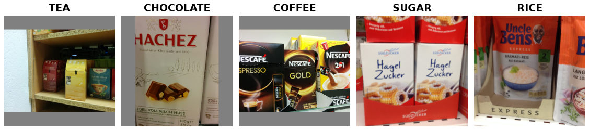

Freiburg Groceries
==================

Overview
--------

``FreiburgGroceries`` loads the authors' released archive and original train/test
lists for 25 grocery categories. Although the paper describes approximately 5,000
images, the downloadable archive contains **4,947 RGB PNG images**, each 256 x 256.
The file is named ``.tar.gz`` but is an uncompressed tar; the loader detects its
actual format.

   Five training examples from the Freiburg Groceries release by Jund, Abdo,
   Eitel, and Burgard (2016). The preview uses the authors' images and class
   names. See `Source and terms`_ for the original archive, attribution, and
   research-use conditions.

Official partitions
-------------------

Select one of five author configurations, ``split0`` through ``split4``.
``split0`` is the default. Both ``train`` and ``test`` are available; there is no
official validation split. Labels and split lists are pinned to author repository
commit ``8827d2f61c2838756a069562b1c2ff53568ae33b``.

.. list-table::
   :header-rows: 1

   * - Config
     - Training images
     - Test images
   * - ``split0``
     - 3,929
     - 1,018
   * - ``split1``
     - 3,989
     - 958
   * - ``split2``
     - 3,962
     - 977
   * - ``split3``
     - 3,937
     - 995
   * - ``split4``
     - 3,943
     - 999

Each published training list has 7,425 rows because the authors oversampled
smaller classes for their training procedure. The loader returns **each training
image path once**, in first-occurrence order, preserving the original unbalanced
class distribution. Author train/test membership and test ordering are unchanged.
Train and test image paths are disjoint within each configuration.

Configurations 2, 3 and 4 omit 8, 15 and 5 archive images, respectively. The loader
follows the published membership rather than adding unlisted images. Different
configurations are alternative experiments and must not be concatenated as
disjoint datasets. Any additional validation split is user-defined.

The release does not provide physical product instance IDs, so path-disjointness
does not establish independence of real-world product instances.

Source paths also do not imply unique pixels: the archive contains 14 pairs of
different paths with identical decoded RGB arrays (4,933 unique RGB arrays among
4,947 files). Some identical images occur across the published train/test
boundary. Applications requiring unseen-image evaluation should audit decoded
pixels and explicitly report any experiment-level exclusions; the loader retains
the authors' file membership.

Fields and labels
-----------------

* ``image``: RGB PIL image by default; float32 CHW tensor with ``with_format("torch")``.
* ``label``: integer 0--24, using the authors' ``classid.txt`` order below.
* ``image_id``: relative source path, for example ``TEA/TEA0123.png``.

The label order is **not alphabetical**:

.. code-block:: text

    0 CANDY       1 JUICE       2 VINEGAR      3 OIL         4 CHOCOLATE
    5 PASTA       6 RICE        7 MILK         8 SPICES      9 HONEY
    10 JAM        11 NUTS       12 CHIPS       13 SODA       14 COFFEE
    15 BEANS      16 TEA        17 CORN        18 CEREAL     19 CAKE
    20 SUGAR      21 WATER      22 FLOUR       23 TOMATO_SAUCE  24 FISH

Usage
-----

.. code-block:: python

    from torch.utils.data import DataLoader
    from stable_datasets.images import FreiburgGroceries

    data = FreiburgGroceries(
        config_name="split0",
        download_dir="./data/downloads",
        processed_cache_dir="./data/processed",
    )
    batch = next(iter(DataLoader(data["train"].with_format("torch"), batch_size=8)))
    assert batch["image"].shape == (8, 3, 256, 256)

The shared builder caches each configuration separately. Version 1.0.1 uses a
new processed cache instead of reopening the oversampled version 1.0.0 cache;
existing raw downloads are reused. Source archives are
SHA-256 checked on download. Parsing checks the class vocabulary, path/label
agreement, train/test overlap, duplicate test entries, and missing or non-regular
image members. Archive paths are never extracted onto the filesystem.

Source and terms
----------------

* `Author homepage and terms <http://www2.informatik.uni-freiburg.de/~eitel/freiburg_groceries_dataset.html>`_
* `Author code and split lists <https://github.com/PhilJd/freiburg_groceries_dataset/tree/8827d2f61c2838756a069562b1c2ff53568ae33b>`_
* `Image archive <http://aisdatasets.informatik.uni-freiburg.de/freiburg_groceries_dataset/freiburg_groceries_dataset.tar.gz>`_
* Images SHA-256: ``35c18d03bb6ed057f12a3c5aea0ac5eef9b8e1d5965d1e32142b7d1f1469e3f0``.
* Annotations SHA-256: ``b07ba6e6c3760cb909f4b92de41f7ab505c3a910f8736613ea4b9712537aafb9``.

The authors permit research use, require consent for commercial use, and request
citation of their paper. The source image server was accessible over its published
HTTP URL; HTTPS was unavailable during verification. A pinned checksum verifies
the downloaded bytes. These terms are separate from the library's software license.
The five attributed preview images above are included for dataset documentation;
the full source image archive is not included.

Citation
--------

.. code-block:: bibtex

    @article{jund2016groceries,
      title={The Freiburg Groceries Dataset},
      author={Jund, Philipp and Abdo, Nichola and Eitel, Andreas and Burgard, Wolfram},
      journal={arXiv preprint arXiv:1611.05799},
      year={2016}
    }
