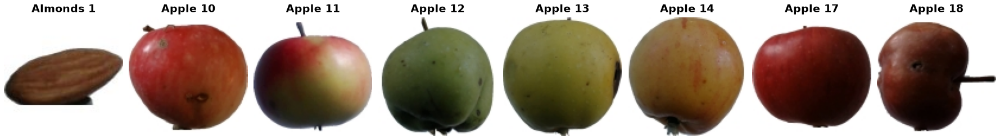

Fruits-360
==========

.. raw:: html

   

   
   
   
   

Overview
--------

Fruits-360 is an image classification dataset of fruits, vegetables, nuts, seeds and mushrooms. Each object was filmed while rotating on a slow motor (3 rpm) in front of a white sheet of paper, and the background was then removed with a flood-fill algorithm and replaced with pure white. Frames are resized to 100×100 RGB. Different varieties of the same fruit (e.g. *Apple Golden 1* and *Apple Granny Smith 1*) are separate classes, and the numeric suffix distinguishes different filming sessions of the same kind.

- **Train**: 147,416 images
- **Test**: 49,106 images
- **Classes**: 274

The official Training/Test partitions are kept as released. Since the upstream repository is updated in place, the builder pins version ``2026.10.18.2`` (commit ``18fbaa1``). A few upstream class folders differ only in letter case (``Blackberry 3`` / ``BlackBerry 3`` and ``Blackberry 4`` / ``BlackBerry 4``) and contain disjoint images of the same class; these are merged, giving the 274 classes reported by the authors.

Because consecutive frames of one rotating object are nearly identical and the train and test images come from the same videos, test accuracy on Fruits-360 is typically very high.

Data Structure
--------------

When accessing an example using ``ds[i]``, you will receive a dictionary with the following keys:

.. list-table::
   :header-rows: 1
   :widths: 20 20 60

   * - Key
     - Type
     - Description
   * - ``image``
     - ``PIL.Image.Image``
     - 100×100 RGB image of a single object on a white background
   * - ``label``
     - int
     - Class label (0-273)

Usage Example
-------------

**Basic Usage**

.. code-block:: python

    from stable_datasets.images.fruits360 import Fruits360

    # First run will download + prepare cache, then return the split as a HF Dataset
    ds_train = Fruits360(split="train")
    ds_test = Fruits360(split="test")

    # If you omit the split (split=None), you get a DatasetDict with all available splits
    ds_all = Fruits360(split=None)

    sample = ds_train[0]
    print(sample.keys())  # {"image", "label"}
    print(ds_train.info.features["label"].int2str(sample["label"]))  # e.g. "Almonds 1"

    # Optional: make it PyTorch-friendly
    ds_train_torch = ds_train.with_format("torch")

References
----------

- Homepage: https://github.com/fruits-360
- Kaggle: https://www.kaggle.com/moltean/fruits
- License: CC BY-SA 4.0

Citation
--------

.. code-block:: bibtex

    @article{muresan2018fruit,
      title={Fruit recognition from images using deep learning},
      author={Mure{\c{s}}an, Horea and Oltean, Mihai},
      journal={Acta Universitatis Sapientiae, Informatica},
      volume={10},
      number={1},
      pages={26--42},
      year={2018}
    }
