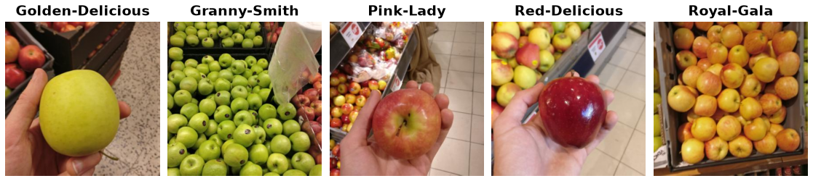

Grocery Store
=============

.. raw:: html

   

   
   
   
   

Overview
--------

The Grocery Store dataset contains natural images of grocery items (fruits, vegetables and carton items such as juice, milk and yoghurt) taken with a smartphone camera in grocery stores. Every image has two labels: a fine-grained class (81 classes, e.g. *Granny-Smith*) and the coarse-grained class it belongs to (43 classes, e.g. *Apple*). Many fine-grained classes look alike, such as the five apple varieties below, or milk cartons of different brands and fat levels.

- **Train**: 2,640 images
- **Validation**: 296 images
- **Test**: 2,485 images

Most images are 348×348 pixels; the rest are 348×464 or 464×348.

Data Structure
--------------

When accessing an example using ``ds[i]``, you will receive a dictionary with the following keys:

.. list-table::
   :header-rows: 1
   :widths: 20 20 60

   * - Key
     - Type
     - Description
   * - ``image``
     - ``PIL.Image.Image``
     - RGB image, usually 348×348
   * - ``label``
     - int
     - Fine-grained class label (0-80)
   * - ``coarse_label``
     - int
     - Coarse-grained class label (0-42)

Usage Example
-------------

**Basic Usage**

.. code-block:: python

    from stable_datasets.images import GroceryStore

    # First run will download + prepare cache, then return the split
    ds_train = GroceryStore(split="train")
    ds_val = GroceryStore(split="validation")
    ds_test = GroceryStore(split="test")

    sample = ds_train[0]
    print(sample.keys())  # {"image", "label", "coarse_label"}

    # Map both labels to class names
    fine_names = ds_train.features["label"].names
    coarse_names = ds_train.features["coarse_label"].names
    print(fine_names[sample["label"]])  # Golden-Delicious
    print(coarse_names[sample["coarse_label"]])  # Apple

    # Optional: make it PyTorch-friendly
    ds_train_torch = ds_train.with_format("torch")

Notes
-----

- The validation split only has images of 60 of the 81 fine-grained classes (37 of the 43 coarse-grained ones).
- The README of the dataset repository mentions 42 coarse-grained classes and a validation set of 292 images from 59 classes. The files at the commit used here (``classes.csv`` and ``val.txt``) have 43 coarse-grained classes and 296 validation images from 60 classes; the builder follows these files.
- The repository also has an iconic image and a product description for each class. These are not part of this builder, which only loads the natural images and their labels.

References
----------

- Homepage: https://github.com/marcusklasson/GroceryStoreDataset
- Paper: https://arxiv.org/abs/1901.00711
- License: MIT License

Citation
--------

.. code-block:: bibtex

    @inproceedings{klasson2019hierarchical,
      title={A Hierarchical Grocery Store Image Dataset with Visual and Semantic Labels},
      author={Klasson, Marcus and Zhang, Cheng and Kjellstr{\"o}m, Hedvig},
      booktitle={IEEE Winter Conference on Applications of Computer Vision (WACV)},
      year={2019}
    }
