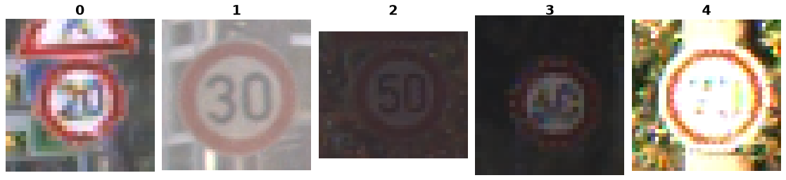

GTSRB
=====

Overview
--------

The German Traffic Sign Recognition Benchmark (GTSRB) is an image classification
dataset with 43 traffic sign classes. The official final distribution has 39,209
training images and 12,630 test images, for 51,839 images in total. There is no
validation split. Labels retain the benchmark's integer class IDs, 0 through 42;
the ``ClassLabel`` names are the corresponding numeric strings.

The original benchmark images are PPM files with variable width and height.
The downloaded Parquet copy stores them as PNG. The builder decodes them as RGB
without resizing, cropping, padding, or normalization. Their decoded pixels
and dimensions match the official images.

The Parquet files contain the official training and labeled test splits. The
builder reads their image and label columns. Width, height, and sign-region
coordinates are also present in the source files but are not exposed as dataset
columns.

Data Structure
--------------

Each example has these fields:

.. list-table::
   :header-rows: 1
   :widths: 20 20 60

   * - Key
     - Type
     - Description
   * - ``image``
     - ``PIL.Image.Image``
     - Original-size RGB traffic sign image
   * - ``label``
     - int
     - Official class ID, 0 through 42

Usage Example
-------------

.. code-block:: python

   from stable_datasets.images import GTSRB

   train = GTSRB(split="train")
   test = GTSRB(split="test")

   print(len(train))  # 39209
   print(len(test))   # 12630

   sample = train[0]
   print(sample.keys())
   print(sample["image"].size)
   print(sample["label"])

Source and License
------------------

The `maintained benchmark distribution
<https://github.com/houbensebastian/GermanTrafficSignBenchmarks>`_ links to
the `official ERDA/SID GTSRB archive
<https://sid.erda.dk/public/archives/daaeac0d7ce1152aea9b61d9f1e19370/published-archive.html>`_.
This builder downloads a `community-hosted Parquet copy on Hugging Face
<https://huggingface.co/datasets/ilee0022/GTSRB>`_ at a pinned revision.
All 51,839 images were compared locally with the official ZIPs: split
membership, labels, dimensions, and decoded RGB pixels matched. The benchmark
and official archive do not state a license suitable for the dataset license
field, so it is left empty.

Citation
--------

.. code-block:: bibtex

   @inproceedings{Stallkamp-IJCNN-2011,
     author = {Johannes Stallkamp and Marc Schlipsing and Jan Salmen and Christian Igel},
     title = {The {G}erman {T}raffic {S}ign {R}ecognition {B}enchmark: A multi-class classification competition},
     booktitle = {IEEE International Joint Conference on Neural Networks},
     pages = {1453--1460},
     year = {2011}
   }
