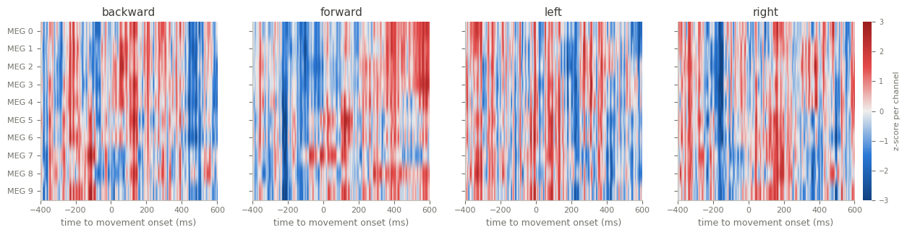

HandMovementDirection
=====================

.. raw:: html

   

   
   
   
   
   

Overview
--------

Multivariate time series classification dataset from the UEA archive (Bagnall et al., 2018), based on data
set 3 of BCI Competition IV (Tangermann et al., 2012), recorded by Waldert et al. (2008). Two healthy subjects
moved a joystick with the right hand and wrist from a center position toward one of four self-chosen targets
while their brain activity was recorded with MEG. Each trial covers 0.4 s before to 0.6 s after movement
onset: 10 MEG channels above the motor areas, resampled to 400 Hz (400 steps).

The archive keeps the competition's train/test split but merges the two subjects. The test set is small,
so one trial changes test accuracy by 1.35 percentage points, and the task is hard: the published Multiverse
results on this split range from below the majority-class rate (1NN-DTW) to about 51 % (ROCKET). The loader
passes the archive's data through unchanged.

- **Train**: 160 trials (40 per class).
- **Test**: 74 trials.

Class names are the archive's labels in lower case: ``backward``, ``forward``, ``left``, ``right``.

Data Structure
--------------

.. list-table::
   :header-rows: 1
   :widths: 20 20 60

   * - Key
     - Type
     - Description
   * - ``series``
     - list of list of float32
     - MEG recording, shape ``(400, 10)``: time steps by channels
   * - ``label``
     - int
     - Movement direction (0-3)

Usage Example
-------------

.. code-block:: python

    import numpy as np
    from stable_datasets.timeseries import HandMovementDirection

    train = HandMovementDirection(split="train")
    sample = train[0]
    x = np.asarray(sample["series"])  # (400, 10)
    print(x.shape, train.features["label"].names[sample["label"]])

References
----------

- Homepage: https://timeseriesclassification.com/description.php?Dataset=HandMovementDirection
- Archive record: https://doi.org/10.5281/zenodo.11206224
- Competition: https://bbci.de/competition/iv/
- Recording paper: Waldert et al. (2008), Hand movement direction decoded from MEG and EEG, Journal of Neuroscience 28(4), https://doi.org/10.1523/JNEUROSCI.5171-07.2008
- License: CC BY 4.0

Citation
--------

.. code-block:: bibtex

    @article{tangermann2012review,
      title={Review of the BCI Competition IV},
      author={Tangermann, Michael and Müller, Klaus-Robert and Aertsen, Ad and Birbaumer, Niels and Braun, Christoph and Brunner, Clemens and Leeb, Robert and Mehring, Carsten and Miller, Kai J. and Müller-Putz, Gernot R. and Nolte, Guido and Pfurtscheller, Gert and Preissl, Hubert and Schalk, Gerwin and Schlögl, Alois and Vidaurre, Carmen and Waldert, Stephan and Blankertz, Benjamin},
      journal={Frontiers in Neuroscience},
      volume={6},
      pages={55},
      year={2012}
    }

    @article{bagnall2018uea,
      title={The UEA multivariate time series classification archive, 2018},
      author={Bagnall, Anthony and Dau, Hoang Anh and Lines, Jason and Flynn, Michael and Large, James and Bostrom, Aaron and Southam, Paul and Keogh, Eamonn},
      journal={arXiv preprint arXiv:1811.00075},
      year={2018}
    }
