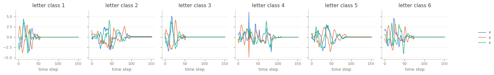

Handwriting
===========

.. raw:: html

   

   
   
   
   
   

Overview
--------

Multivariate time series classification dataset from the UEA archive (Bagnall et al., 2018), used by
Shokoohi-Yekta et al. (2017). It holds the motion of a smart watch while its wearer writes the 26 letters
of the alphabet: x, y and z acceleration (3 channels), 152 steps.

Most recordings are shorter than 152 steps and end in a constant segment in which all three channels hold
their last value (992 of 1000 recordings end in at least 10 such steps; the median is 63), so they appear
padded to equal length. The training set is small and unbalanced (2 to 11 recordings per class). The loader
passes the archive's data through unchanged.

- **Train**: 150 recordings.
- **Test**: 850 recordings.

The archive labels the letters ``1.0`` to ``26.0`` without documenting which number is which letter, so the
class names are the numbers ``1`` to ``26``.

Data Structure
--------------

.. list-table::
   :header-rows: 1
   :widths: 20 20 60

   * - Key
     - Type
     - Description
   * - ``series``
     - list of list of float32
     - Smart watch accelerometer recording, shape ``(152, 3)``: time steps by channels
   * - ``label``
     - int
     - Letter class (0-25)

Usage Example
-------------

.. code-block:: python

    import numpy as np
    from stable_datasets.timeseries import Handwriting

    train = Handwriting(split="train")
    sample = train[0]
    x = np.asarray(sample["series"])  # (152, 3)
    print(x.shape, train.features["label"].names[sample["label"]])

References
----------

- Homepage: https://timeseriesclassification.com/description.php?Dataset=Handwriting
- Archive record: https://doi.org/10.5281/zenodo.11206227
- Original paper: https://doi.org/10.1007/s10618-016-0455-0
- License: CC BY 4.0

Citation
--------

.. code-block:: bibtex

    @article{shokoohiyekta2017generalizing,
      title={Generalizing DTW to the multi-dimensional case requires an adaptive approach},
      author={Shokoohi-Yekta, Mohammad and Hu, Bing and Jin, Hongxia and Wang, Jun and Keogh, Eamonn},
      journal={Data Mining and Knowledge Discovery},
      volume={31},
      number={1},
      pages={1--31},
      year={2017}
    }

    @article{bagnall2018uea,
      title={The UEA multivariate time series classification archive, 2018},
      author={Bagnall, Anthony and Dau, Hoang Anh and Lines, Jason and Flynn, Michael and Large, James and Bostrom, Aaron and Southam, Paul and Keogh, Eamonn},
      journal={arXiv preprint arXiv:1811.00075},
      year={2018}
    }
