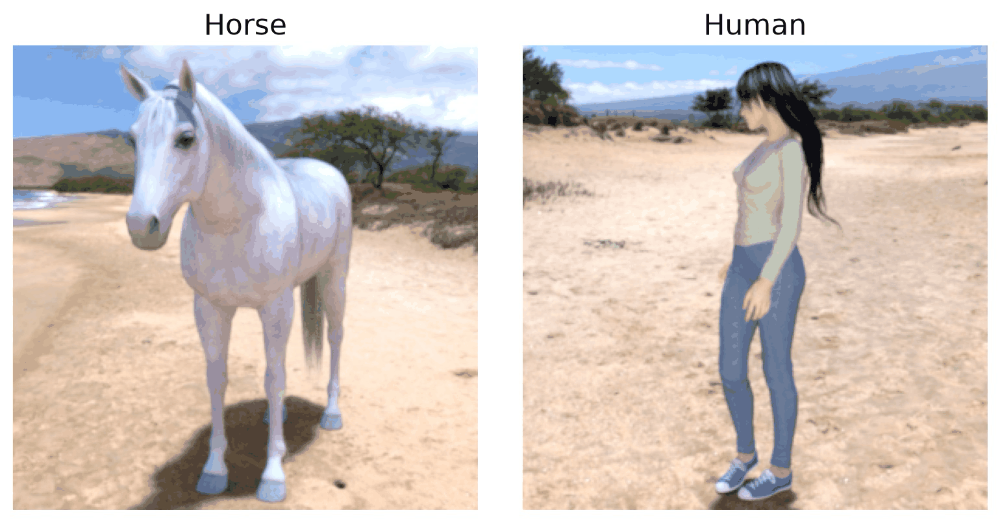

Horses vs. Humans
=================

.. raw:: html

   

   
   
   
   

Overview
--------

Horses vs. Humans is a binary image classification dataset
created by Laurence Moroney. It contains images of horses
and humans, organized into two categories.

Each image has a resolution of 300x300 pixels and is loaded
as an RGB image. The dataset is suitable for supervised image
classification, computer vision research, and transfer learning.

This implementation uses the Horses vs. Humans dataset
hosted on Google Cloud Storage and preserves its original
training and validation splits.

Dataset Splits
--------------

The dataset contains two predefined splits:

- **Train**: 1,027 images from the original training archive.
- **Test**: 256 images from the original validation archive.

The loader does not randomly divide the dataset.
No separate validation split is provided.

The original validation split is exposed as the ``test``
split for consistency with other datasets in this library.

Data Structure
--------------

Each dataset example contains the following fields:

.. list-table::
   :header-rows: 1
   :widths: 20 25 55

   * - Key
     - Type
     - Description
   * - ``image``
     - ``PIL.Image.Image``
     - RGB image with resolution 300x300.
   * - ``label``
     - ``int``
     - Zero-based category index.

Images are converted to RGB using Pillow. The loader supports
``.jpg``, ``.jpeg``, and ``.png`` files.

The dataset contains two classes:

.. list-table::
   :header-rows: 1
   :widths: 20 40

   * - Label
     - Class Name
   * - ``0``
     - horses
   * - ``1``
     - humans

Class names are defined in a fixed order and assigned
integer labels starting from zero.

The same label mapping is used for both splits to ensure
consistent category indices.

Usage Example
-------------

**Basic Usage**

.. code-block:: python

    from stable_datasets.images.horse_or_human import HorseOrHuman

    def main():
        train = HorseOrHuman(split="train")
        test = HorseOrHuman(split="test")

        print("Training examples:", len(train))
        print("Test examples:", len(test))

        sample = train[0]

        print("Image size:", sample["image"].size)
        print("Image mode:", sample["image"].mode)
        print("Label:", sample["label"])

        # Image size: (300, 300)
        # Image mode: RGB

        print("Number of classes:",
              train.features["label"].num_classes)

    if __name__ == "__main__":
        main()

**Loading All Splits**

.. code-block:: python

    from stable_datasets.images.horse_or_human import HorseOrHuman

    datasets = HorseOrHuman(split=None)

    train = datasets["train"]
    test = datasets["test"]

    print(len(train), len(test))

**Displaying an Image**

.. code-block:: python

    import matplotlib.pyplot as plt
    from stable_datasets.images.horse_or_human import HorseOrHuman

    train = HorseOrHuman(split="train")
    sample = train[0]

    plt.imshow(sample["image"])
    plt.title(f"Class: {sample['label']}")
    plt.axis("off")
    plt.show()

Implementation Details
----------------------

The loader downloads the dataset as two ZIP archives
and reads images directly using Python's ``zipfile`` module.

The loading process is:

1. Download the training and validation ZIP archives.
2. Open the requested ZIP archive.
3. Find supported image files.
4. Extract class names from the parent directory.
5. Map ``horses`` to label 0 and ``humans`` to label 1.
6. Convert images to RGB using Pillow.
7. Return each image with its corresponding label.

The loader preserves the original image resolution and does
not apply normalization, resizing, or augmentation.

Users may apply model-specific preprocessing separately.
For example, vision transformers may require resizing
images to 224x224 pixels.

The loader uses a fixed class mapping to ensure consistent
labels across the training and test splits.

Related Datasets
----------------

- **Cats vs. Dogs**: Binary animal image classification.
- **Rock Paper Scissors**: Three-class image classification.
- **CIFAR-10**: General-purpose RGB image classification.
- **ImageNet**: Large-scale object recognition.

References
----------

- `TensorFlow Datasets: Horses or Humans <https://www.tensorflow.org/datasets/catalog/horses_or_humans>`_
- `Training dataset <https://storage.googleapis.com/learning-datasets/horse-or-human.zip>`_
- `Validation dataset <https://storage.googleapis.com/learning-datasets/validation-horse-or-human.zip>`_
- **License**: `Creative Commons Attribution 2.0 (CC BY 2.0) <https://creativecommons.org/licenses/by/2.0/>`_

Citation
--------

.. code-block:: bibtex

    @misc{horses_or_humans,
    author = {Laurence Moroney},
    title = {Horses or Humans Dataset},
    month = feb,
    year = {2019},
    url = {http://laurencemoroney.com/horses-or-humans-dataset}
    }
