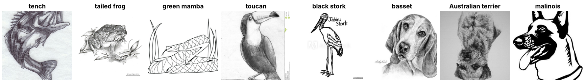

ImageNet-Sketch
===============

.. raw:: html

   

   
   
   
   
   

Overview
--------

ImageNet-Sketch is a test set for out-of-domain generalization of ImageNet-1K classifiers. It contains black-and-white sketches of all 1000 ImageNet-1K classes, collected with Google Image queries "sketch of __" and cleaned manually. Classes with fewer than 50 images were augmented by flipping and rotating.

- **Test**: 50,889 images, 50 or 51 per class
- **Train**: N/A (test-only dataset)

The official README gives 50,000 images; the released archive has 50,889, and the builder loads all of them. Labels use the ``ImageNet1K`` label space and order, so ImageNet-1K classifiers are evaluated without remapping their outputs.

Many images repeat within a class. Comparing grayscale thumbnails up to a flip or 90° rotation, 19,741 images (39%) are copies of another image in the same class: the authors' flip and rotation augmentation, or the same drawing scraped twice (e.g. with and without a watermark). Some classes are a single drawing; ``n02113712`` (miniature poodle) is one sketch repeated 50 times. Keep copies on the same side of any train/val split made from this set.

Data Structure
--------------

When accessing an example using ``ds[i]``, you will receive a dictionary with the following keys:

.. list-table::
   :header-rows: 1
   :widths: 20 20 60

   * - Key
     - Type
     - Description
   * - ``image``
     - ``PIL.Image.Image``
     - RGB sketch (variable size)
   * - ``label``
     - int
     - ImageNet-1K class label (0-999), in the ImageNet-1K WordNet ID order

The 42,039 RGB JPEGs are stored byte-identical to the archive. The other 8,850 files are grayscale JPEGs; they are converted with ``convert("RGB")`` and stored as lossless PNG. torchvision and timm loaders apply the same conversion at read time, so accuracy is unchanged, and batches never mix 1- and 3-channel images (see `issue #68 <https://github.com/galilai-group/stable-datasets/issues/68>`_).

Usage Example
-------------

**Basic Usage**

.. code-block:: python

    from stable_datasets.images import ImageNetSketch

    # Load the test set (only split available)
    ds = ImageNetSketch(split="test")

    sample = ds[0]
    print(sample.keys())  # {"image", "label"}

    # Labels are ImageNet-1K WordNet IDs
    wnids = ds.info.features["label"].names
    print(wnids[sample["label"]])  # e.g. "n01440764"

**Evaluating an ImageNet-1K Classifier**

.. code-block:: python

    import timm
    import torch
    from timm.data import create_transform, resolve_model_data_config
    from torch.utils.data import DataLoader

    from stable_datasets.images import ImageNetSketch

    model = timm.create_model("resnet50.tv_in1k", pretrained=True).eval()
    transform = create_transform(**resolve_model_data_config(model))

    def preprocess(sample):
        return {"image": transform(sample["image"]), "label": sample["label"]}

    ds = ImageNetSketch(split="test").with_transform(preprocess)
    loader = DataLoader(ds, batch_size=256, num_workers=8)

    correct = 0
    with torch.no_grad():
        for batch in loader:
            logits = model(batch["image"])
            correct += (logits.argmax(dim=1) == batch["label"]).sum().item()
    print(f"Top-1 accuracy: {correct / len(ds):.2%}")

Validation
----------

Top-1 accuracy (%) of pretrained timm models evaluated on all 50,889 images with timm's eval transform (``examples/validate_imagenet_v2_sketch.py``), compared with timm's ``results-sketch.csv``.

.. list-table::
   :header-rows: 1
   :widths: 40 20 20 20

   * - Model
     - This builder
     - timm reference
     - Difference
   * - ``resnet50.tv_in1k``
     - 24.096
     - 24.064
     - +0.032
   * - ``resnet18.tv_in1k``
     - 20.226
     - 20.238
     - -0.012

**Linear probe.** ``examples/probe_imagenet_sketch.py`` trains a linear classifier on frozen ``resnet50.tv_in1k`` features (timm eval transform, no augmentation). It holds out about 20% of each class for validation, keeping near-duplicates together so no drawing appears in both splits. The weight decay is chosen on an inner split of the training rows. This gives 41,227 training and 9,662 validation images; the validation images cover 990 classes, since 10 classes consist of a single repeated drawing and stay in training.

.. list-table::
   :header-rows: 1
   :widths: 50 25 25

   * - Classifier on frozen ``resnet50.tv_in1k`` features
     - Train top-1
     - Val top-1
   * - ImageNet-1K head (not trained on sketches)
     - 23.89
     - 24.95
   * - Linear probe trained on the train split
     - 97.12
     - 44.11

Related Datasets
----------------

- :doc:`imagenet_v2`: A fresh ImageNet-1K test set for natural distribution shift
- :doc:`tiny_imagenet_c`: Tiny ImageNet with synthetic common corruptions
- :doc:`cifar10_c`: CIFAR-10 with synthetic common corruptions

References
----------

- Paper: `Learning Robust Global Representations by Penalizing Local Predictive Power <https://arxiv.org/abs/1905.13549>`_ (NeurIPS 2019)
- Homepage: https://github.com/HaohanWang/ImageNet-Sketch
- Hugging Face dataset: https://huggingface.co/datasets/songweig/imagenet_sketch
- License: Unknown (not specified by the authors)

Citation
--------

.. code-block:: bibtex

    @inproceedings{wang2019learning,
      title={Learning Robust Global Representations by Penalizing Local Predictive Power},
      author={Wang, Haohan and Ge, Songwei and Lipton, Zachary and Xing, Eric P},
      booktitle={Advances in Neural Information Processing Systems},
      pages={10506--10518},
      year={2019}
    }
