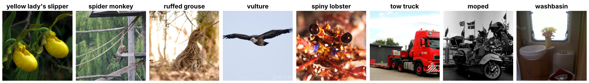

ImageNetV2
==========

.. raw:: html

   

   
   
   
   
   

Overview
--------

ImageNetV2 is a set of three new test sets for ImageNet-1K. Recht et al. collected new images from Flickr and labeled them by following the process used to build the original ImageNet validation set. Top-1 accuracy of a wide range of ImageNet models drops by 11 to 14 percentage points on these images compared with the original validation set.

- **Test**: 10,000 images per variant (10 images for each of the 1,000 classes)
- **Train**: N/A (test-only dataset for evaluating ImageNet-1K classifiers)

Labels use the same 1,000 WordNet IDs, in the same order, as ``ImageNet1K``, so an ImageNet-1K classifier can be evaluated without remapping its outputs.

Variants
--------

The variants differ in how images were chosen by their selection frequency, the fraction of Amazon Mechanical Turk workers who said an image contains the class. Pick one with ``config_name``.

.. list-table::
   :header-rows: 1
   :widths: 25 30 45

   * - ``config_name``
     - Original name
     - Selection rule
   * - ``matched-frequency`` (default)
     - MatchedFrequency (``imagenetv2-b-33``)
     - Sampled so that the distribution of selection frequencies matches the original ImageNet validation set. This is the variant usually reported as ImageNetV2.
   * - ``threshold-0.7``
     - Threshold0.7 (``imagenetv2-a-44``)
     - Sampled from images with a selection frequency of at least 0.7.
   * - ``top-images``
     - TopImages (``imagenetv2-c-12``)
     - The images with the highest selection frequency for each class.

Data Structure
--------------

When accessing an example using ``ds[i]``, you will receive a dictionary with the following keys:

.. list-table::
   :header-rows: 1
   :widths: 20 20 60

   * - Key
     - Type
     - Description
   * - ``image``
     - ``PIL.Image.Image``
     - RGB image (variable size)
   * - ``label``
     - int
     - ImageNet-1K class index (0-999), in the same WordNet ID order as ``ImageNet1K``

In the original archives, class folders are named by this integer class index (``0`` to ``999``) rather than by WordNet ID. The WordNet ID of a label is ``ds.info.features["label"].names[label]``.

All 30,000 source images are RGB JPEGs and are stored byte-identical to the archive. A non-RGB file would be converted with ``convert("RGB")`` and stored as lossless PNG, so batches never mix channel counts (see `issue #68 <https://github.com/galilai-group/stable-datasets/issues/68>`_).

Usage Example
-------------

**Basic Usage**

.. code-block:: python

    from stable_datasets.images import ImageNetV2

    # Downloads and caches on first use. The default variant is "matched-frequency".
    ds = ImageNetV2(split="test")
    ds_threshold = ImageNetV2(split="test", config_name="threshold-0.7")
    ds_top = ImageNetV2(split="test", config_name="top-images")

    sample = ds[0]
    print(sample.keys())  # {"image", "label"}

    wnids = ds.info.features["label"].names
    print(wnids[sample["label"]])  # WordNet ID, e.g. "n01440764"

    # Optional: make it PyTorch-friendly
    ds_torch = ds.with_format("torch")

**Evaluating an ImageNet-1K Classifier**

.. code-block:: python

    import timm
    import torch
    from torch.utils.data import DataLoader

    from stable_datasets.images import ImageNetV2

    model = timm.create_model("resnet50.tv_in1k", pretrained=True).eval()
    preprocess = timm.data.create_transform(**timm.data.resolve_data_config({}, model=model))

    def transform(sample):
        return {"image": preprocess(sample["image"]), "label": sample["label"]}

    ds = ImageNetV2(split="test").with_transform(transform)
    loader = DataLoader(ds, batch_size=256, num_workers=8)

    correct = 0
    with torch.no_grad():
        for batch in loader:
            predictions = model(batch["image"]).argmax(dim=1)
            correct += (predictions == batch["label"]).sum().item()

    print(f"Top-1 accuracy: {correct / len(ds):.2%}")

Related Datasets
----------------

- :doc:`imagenet_sketch`: Sketches of the 1,000 ImageNet-1K classes, in the same label space
- :doc:`tiny_imagenet`: A 200-class, 64×64 subset of ImageNet
- :doc:`tiny_imagenet_c`: Common corruptions applied to Tiny ImageNet
- :doc:`cifar10_c`: Common corruptions applied to CIFAR-10

References
----------

- Paper: `Do ImageNet Classifiers Generalize to ImageNet? <http://proceedings.mlr.press/v97/recht19a.html>`_ (ICML 2019)
- Official repository: https://github.com/modestyachts/ImageNetV2
- Dataset download (authors' Hugging Face mirror): https://huggingface.co/datasets/vaishaal/ImageNetV2
- License: MIT for the code; the images were collected from Flickr and, per the authors, can be used the same way as the original ImageNet dataset

Citation
--------

.. code-block:: bibtex

    @inproceedings{recht2019imagenet,
      title={Do ImageNet Classifiers Generalize to ImageNet?},
      author={Recht, Benjamin and Roelofs, Rebecca and Schmidt, Ludwig and Shankar, Vaishaal},
      booktitle={International Conference on Machine Learning},
      pages={5389--5400},
      year={2019}
    }
