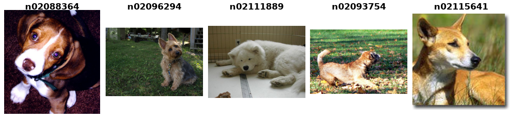

Imagewoof
=========

Imagewoof contains ten dog classes from ImageNet. This builder uses the official
full-resolution ``imagewoof2.tgz`` release, with original directory labels and
9,025 training images and 3,929 validation images. These counts were obtained
from the official archive listing. Classes are not uniformly sized.

The archive's ``val`` directory is exposed as ``validation``. There is no test
split. The supplied noisy-label CSV is ignored. The 160px and 320px releases
are not configurations of this builder.

Usage
-----

.. code-block:: python

    from stable_datasets.images import Imagewoof

    splits = Imagewoof()
    train = splits["train"]
    validation = splits["validation"]
    sample = train[0]
    image, label = sample["image"], sample["label"]

Each row contains an RGB ``PIL.Image.Image`` and an integer ``label`` from 0 to 9.
Images retain their source dimensions. Grayscale and other image modes are
converted to RGB; alpha channels are discarded. Resize/crop transforms belong
in the training pipeline. Variable-size images require a common-size transform
or a custom collator before ordinary tensor batching.

Labels follow this fixed order of ImageNet class identifiers:

.. code-block:: text

    0 n02086240    1 n02087394    2 n02088364    3 n02089973    4 n02093754
    5 n02096294    6 n02099601    7 n02105641    8 n02111889    9 n02115641

Source and citation
-------------------

`Official Imagewoof page <https://github.com/fastai/imagenette#imagewoof>`_

.. code-block:: bibtex

    @software{Howard_Imagewoof_2019,
        title={Imagewoof: a subset of 10 classes from Imagenet that aren't so easy to classify},
        author={Jeremy Howard},
        year={2019},
        month={March},
        publisher={GitHub},
        url={https://github.com/fastai/imagenette#imagewoof}
    }
