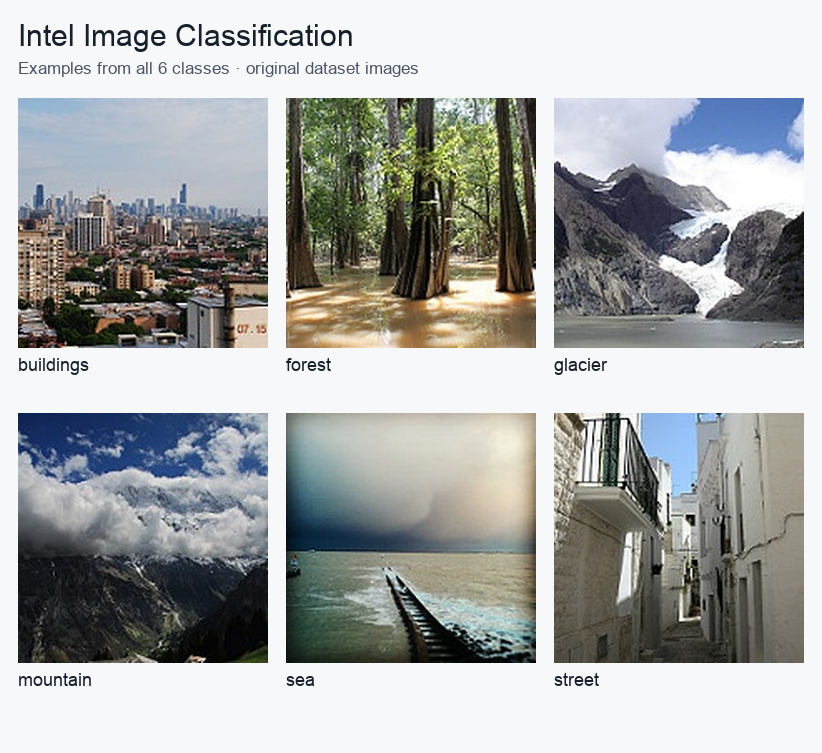

Intel Image Classification
==========================

Overview
--------

Intel Image Classification is a natural-scene image classification
dataset containing photographs in six categories:

* buildings
* forest
* glacier
* mountain
* sea
* street

The dataset was originally published for an Intel image
classification challenge.

Dataset Information
-------------------

.. list-table::
   :header-rows: 1

   * - Property
     - Value
   * - Task
     - Image classification
   * - Number of classes
     - 6
   * - Original labeled training images
     - 14,034
   * - Original labeled test images
     - 3,000
   * - Builder training images
     - 12,632
   * - Builder validation images
     - 1,402
   * - Total labeled images
     - 17,034
   * - Image format
     - RGB images

Splits
------

The builder preserves the original labeled test set.

The original training set is divided into training and validation
partitions using deterministic, class-stratified image-path hashing.
Within each class, full ZIP-member paths are sorted by
``(SHA256("42:" + path), path)``. The first ``floor(0.1N)`` members form
validation; the rest form training. Split seed 42 is independent of training
seed 0. Output paths are sorted, so ZIP entry order does not affect membership.
A change to member path prefixes may affect assignments. Test membership is
copied directly from ``seg_test`` and never included in this partitioning.

The original unlabeled prediction set is excluded because it does
not provide class labels for supervised evaluation.

Usage
-----

.. code-block:: python

    from stable_datasets.images import IntelImageClassification

    ds_train = IntelImageClassification(split="train")
    ds_valid = IntelImageClassification(split="validation")
    ds_test = IntelImageClassification(split="test")

    ds_all = IntelImageClassification(split=None)

    print(len(ds_train))
    print(len(ds_valid))
    print(len(ds_test))

Each example contains:

* ``image``: The natural-scene image.
* ``label``: An integer class identifier from 0 to 5.

Source
------

* Original dataset: https://www.kaggle.com/datasets/puneet6060/intel-image-classification
* Download: https://www.kaggle.com/api/v1/datasets/download/puneet6060/intel-image-classification

Class mapping
-------------

Labels 0 through 5 mean ``buildings``, ``forest``, ``glacier``, ``mountain``,
``sea``, and ``street``, respectively, for every split.

Download, cache and RGB behavior
--------------------------------

The original public Kaggle ZIP is downloaded and read directly without extraction.
Original RGB bytes are preserved; any non-RGB images are converted to RGB and
encoded as lossless PNG.
First loads build processed split caches; repeated loads reopen them offline.

Default directories are ``~/.stable-datasets/downloads`` and
``~/.stable-datasets/processed``; override them through ``download_dir`` and
``processed_cache_dir``, or set ``STABLE_DATASETS_CACHE_DIR``.

Attribution and usage terms
---------------------------

Credit the Intel Image Classification challenge and Puneet Bansal's
`Kaggle distribution <https://www.kaggle.com/datasets/puneet6060/intel-image-classification>`_.
The downloaded ZIP has no license file. This integration does not assign a
license or transfer the library's code license to the photographs. Consult the source's
current terms before redistribution; no source photographs are included here.

Citation
--------

.. code-block:: bibtex

    @misc{bansal2019intel,
      author={Bansal, Puneet},
      title={Intel Image Classification},
      year={2019},
      howpublished={Kaggle},
      url={https://www.kaggle.com/datasets/puneet6060/intel-image-classification}
    }
