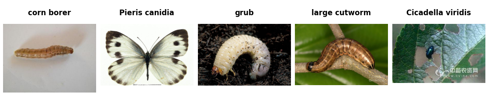

IP102
=====

.. raw:: html

   

   
   
   
   

Overview
--------
IP102 contains 75,222 insect pest images in 102 classes, with a long-tailed
class distribution and varied backgrounds and life stages. This reader loads
the original classification release and preserves its published partitions.
Images are converted to RGB at their original resolution, without resizing.
The separate detection dataset and its bounding boxes are not loaded.

- **Train**: 45,095 images
- **Validation**: 7,508 images
- **Test**: 22,619 images

Data Structure
--------------

.. list-table::
   :header-rows: 1
   :widths: 20 20 60

   * - Key
     - Type
     - Description
   * - ``image``
     - ``PIL.Image.Image``
     - H x W x 3 RGB image at its original resolution
   * - ``label``
     - int
     - Insect class label (0-101)

Labels are read from ``train.txt``, ``val.txt``, and ``test.txt`` and are already
zero-based. Names follow the order of the authors' ``classes.txt``, whose IDs
are one-based. Names retain the authors' spelling. The numerical part of a
filename is not used to infer its class. Examples follow the split-file order.

Usage Example
-------------

.. code-block:: python

    from stable_datasets.images import IP102

    # Downloads the matching image archive and split manifests, then caches Arrow data.
    ds = IP102(split="train")
    sample = ds[0]
    print(sample.keys())  # {"image", "label"}
    print(ds.features["label"].int2str(sample["label"]))

    ds_all = IP102(split=None)  # train, validation, test
    validation = IP102(split="validation")
    test = IP102(split="test")
    ds_torch = ds.with_format("torch")

Download and Provenance
-----------------------
All four assets come from the authors'
`original classification release <https://drive.google.com/drive/folders/1dnw8Z4XIADWBdLX0ecokRwqVmRKJa-QP>`_,
linked in the
`2019 project README <https://github.com/xpwu95/IP102/blob/d5df35f21c2d922261d9e88c26e84cebd3874328/README.md>`_.
The approximately 3.34 GB ``Images.tar`` uses names such as
``Images/IP022001503.jpg``. The later v1.1 image archive uses different
filenames and must not be substituted for this archive with the original
manifests. The class names include the authors' subsequent name corrections.

Downloads use the existing ``gdown`` dependency to handle Google Drive
confirmation. Files are cached in ``<download_dir>/ip102/`` as ``Images.tar``,
``train.txt``, ``val.txt``, and ``test.txt``. Google Drive may impose download
quotas. In that case, download these four files from the release folder and
place them at those paths; the reader reuses existing files. No archive
extraction is required.

References
----------

- `Official project <https://github.com/xpwu95/IP102>`_
- `Original classification release <https://drive.google.com/drive/folders/1dnw8Z4XIADWBdLX0ecokRwqVmRKJa-QP>`_
- `Class names <https://github.com/xpwu95/IP102/blob/abd7defa50dd7268eaa3e7db5bca4ad29ccd17f4/classes.txt>`_
- `Original paper <https://openaccess.thecvf.com/content_CVPR_2019/html/Wu_IP102_A_Large-Scale_Benchmark_Dataset_for_Insect_Pest_Recognition_CVPR_2019_paper.html>`_
- **License**: Free for academic usage; contact the authors for other purposes.

The teaser uses five original training images with labels from ``train.txt``.
Regenerate it with
``PYTHONPATH=. python docs/source/datasets/teasers/generate_ip102_teaser.py --archive /path/to/Images.tar --train-list /path/to/train.txt``.

Citation
--------

.. code-block:: bibtex

    @inproceedings{Wu2019Insect,
      title={IP102: A Large-Scale Benchmark Dataset for Insect Pest Recognition},
      author={Xiaoping Wu and Chi Zhan and Yukun Lai and Ming-Ming Cheng and Jufeng Yang},
      booktitle={IEEE CVPR},
      pages={8787--8796},
      year={2019}
    }
