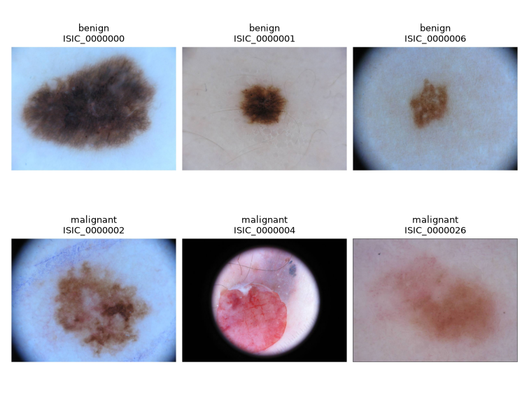

ISIC2016
========

This builder implements **ISIC 2016 Task 3: Lesion Classification**, preserving
the official 900-image training and 379-image test sets. Each row contains
``image`` (PIL image), ``label`` (integer), and ``image_id`` (string).
Original JPEG bytes, dimensions, labels, and source splits are retained.

   Three examples per class from the official training set, selected by image
   ID. Aspect ratios and original labels are preserved; images are not cropped.

Usage
-----

.. code-block:: python

   from stable_datasets.images import ISIC2016

   datasets = ISIC2016()
   train, test = datasets["train"], datasets["test"]
   print(train.features["label"].names)  # ["benign", "malignant"]

   datasets = ISIC2016(data_dir="/data/isic2016")  # Local original assets.

The offline directory contains:

* ``ISBI2016_ISIC_Part3_Training_Data.zip``
* ``ISBI2016_ISIC_Part3_Training_GroundTruth.csv``
* ``ISBI2016_ISIC_Part3_Test_Data.zip``
* ``ISBI2016_ISIC_Part3_Test_GroundTruth.csv``

The CSV files have no header. Training uses ``benign``/``malignant`` and test
uses ``0.0``/``1.0``; both map to 0=benign and 1=malignant. Labels are joined
by image ID independently of ZIP/CSV row order. Duplicate IDs and missing or
extra labels raise errors. Rows are sorted by ID. Use a separate processed
cache when supplying a different source release.

Testing and validation
----------------------

Offline tests check label matching, malformed files, missing assets, original
image bytes, and cache reopening. The complete audit verified all 1,279 images.
See :download:`recorded data checks <audits/scene8_isic2016_protocol_review.json>`.

The builder does not invent a validation split. The main example creates
validation from official training and uses frozen DINO features to train a
linear classifier. Average precision (AP) is the primary metric. Setup and
results are in the :doc:`integration report <experiments/scene8_isic2016/REPORT>`.

Three identical RGB-image pairs cross the official source splits:

.. list-table::
   :header-rows: 1

   * - Training ID
     - Test ID
   * - ISIC_0000280
     - ISIC_0000279
   * - ISIC_0001184
     - ISIC_0001484
   * - ISIC_0001385
     - ISIC_0001685

The main validation excludes these three training records, yielding an 897-image
training/refit pool, and keeps all 379 test images. This uses test pixels for
a disclosed duplicate audit, without using diagnoses or model scores. Training
also contains ``ISIC_0001442`` / ``ISIC_0001742``, which stay together when
fitting/validation roles are created. All original records remain in the builder.
These checks do not establish patient independence or exclude near-duplicates.
The optional supplement retains the official-pool comparison.

Source and license
------------------

Official task: https://challenge.isic-archive.com/landing/2016/39/

Official data index: https://challenge.isic-archive.com/data/

The 2016 challenge data are listed under CC0. Measured SHA-256 values in
``SOURCE`` identify the audited release; they are not publisher signatures.

Citation: Gutman et al., *Skin Lesion Analysis toward Melanoma Detection:
A Challenge at ISBI 2016, hosted by ISIC*, arXiv:1605.01397, 2016.
