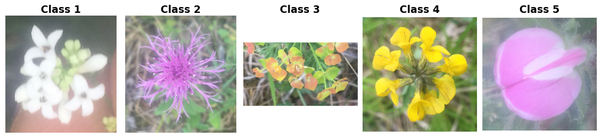

Jena Flowers 30
===============

.. raw:: html

   

   
   
   
   

Overview
--------
The Jena Flowers 30 dataset contains 1,479 images of 30 wild-flowering plant species found on semi-arid grasslands around Jena, Germany. Each class contains 11-70 images. The photographs capture flowers from above under different illumination conditions and at different stages of flowering. Images are converted to RGB without resizing.

The default ``all`` configuration exposes the complete collection as one split:

- **Train**: 1,479 images
- **Validation / Test**: Not provided by this configuration

Use ``all`` to create custom partitions. Here, ``train`` means the full collection, not the training portion of an official benchmark fold, and there is no independent test set.

The ``fold1``, ``fold2``, and ``fold3`` configurations preserve the three official partitions. Each configuration provides disjoint splits covering the complete collection:

- **Train**: 279 images
- **Validation**: 279 images
- **Test**: 921 images

Data Structure
--------------

When accessing an example using ``ds[i]``, you will receive a dictionary with the following keys:

.. list-table::
   :header-rows: 1
   :widths: 20 20 60

   * - Key
     - Type
     - Description
   * - ``image``
     - ``PIL.Image.Image``
     - H x W x 3 RGB image at its original resolution
   * - ``label``
     - int
     - Class label (0-29)

Labels come from ``classlabels.txt`` in ``JF30-1.zip`` and are matched to ``jpg/JFT_*.jpg`` by filename, not by row position. Source IDs 1-30 are converted to integers 0-29. ``ClassLabel.names`` preserves the source IDs as strings ``"1"`` through ``"30"``; the archive does not supply species names.

Official split memberships come from ``trn1.txt`` / ``val1.txt`` / ``tst1.txt`` and the corresponding files for folds 2 and 3. Their integer entries are image filename IDs, not row positions in ``classlabels.txt``.

Usage Example
-------------

**Basic Usage**

.. code-block:: python

    from stable_datasets.images.jena_flowers30 import JenaFlowers30

    # First run downloads the archive and prepares the Arrow cache.
    ds = JenaFlowers30(config_name="all", split="train")

    # Omitting split returns a DatasetDict containing only "train".
    ds_all = JenaFlowers30(split=None)

    sample = ds[0]
    print(sample.keys())  # {"image", "label"}
    print(ds.features["label"].int2str(sample["label"]))  # "1"

    # Optional: make it PyTorch-friendly.
    ds_torch = ds.with_format("torch")

**Official Folds**

.. code-block:: python

    folds = JenaFlowers30(config_name="fold1", split=None)
    train = folds["train"]
    validation = folds["validation"]
    test = folds["test"]

    # Select one split directly from another official fold.
    test_fold2 = JenaFlowers30(config_name="fold2", split="test")

All configurations share the same raw archive download. Prepared Arrow caches are separate for each configuration and split.

References
----------

- Official dataset: https://doi.org/10.7910/DVN/QDHYST
- Original publication: https://doi.org/10.1371/journal.pone.0170629
- License: `Creative Commons Attribution-NonCommercial 4.0 International <https://creativecommons.org/licenses/by-nc/4.0/>`_
- Image copyright: Technische Universitaet Ilmenau. Reuse requires attribution to the original publication and is restricted to non-commercial purposes.

The teaser displays original archive samples ``JFT_00001.jpg``, ``JFT_00018.jpg``, ``JFT_00078.jpg``, ``JFT_00119.jpg``, and ``JFT_00185.jpg``. It can be reproduced with ``python generate_jena_flowers30_teaser.py`` (requires the optional ``remotezip`` and ``matplotlib`` packages), or with ``--archive /path/to/JF30-1.zip`` using an existing download.

Citation
--------

.. code-block:: bibtex

    @article{seeland2017plant,
      author = {Seeland, Marco and Rzanny, Michael and Alaqraa, Nedal and W{\"a}ldchen, Jana and M{\"a}der, Patrick},
      title = {Plant Species Classification Using Flower Images -- A Comparative Study of Local Feature Representations},
      journal = {PLOS ONE},
      volume = {12},
      number = {2},
      pages = {e0170629},
      year = {2017},
      doi = {10.1371/journal.pone.0170629}
    }
