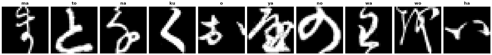

Kuzushiji-49
============

.. raw:: html

   

   
   
   
   

Overview
--------

The Kuzushiji-49 dataset is an image classification benchmark of 270,912 28×28 grayscale images of cursive Japanese (Kuzushiji) hiragana characters across 49 classes: the 46 modern hiragana, two obsolete hiragana (ゐ "wi" and ゑ "we"), and the iteration mark ゝ. It is a larger and harder companion to Kuzushiji-MNIST.

- **Train**: 232,365 images
- **Test**: 38,547 images

Unlike Kuzushiji-MNIST, the classes are highly imbalanced: the training split has between 392 and 6,000 images per class. Balanced (macro-averaged) accuracy is therefore more informative than plain accuracy.

Data Structure
--------------

When accessing an example using ``ds[i]``, you will receive a dictionary with the following keys:

.. list-table::
   :header-rows: 1
   :widths: 20 20 60

   * - Key
     - Type
     - Description
   * - ``image``
     - ``PIL.Image.Image``
     - 28×28 grayscale image
   * - ``label``
     - int
     - Class label (0-48)

Class names are romanized readings in the order of the official class map (``k49_classmap.csv``): ``a``, ``i``, ``u``, ..., ``wo``, ``n``, and ``iteration_mark`` for label 48.

Usage Example
-------------

**Basic Usage**

.. code-block:: python

    from stable_datasets.images.k_mnist49 import KMNIST49

    # First run will download + prepare cache, then return the split as a HF Dataset
    ds = KMNIST49(split="train")

    # If you omit the split (split=None), you get a DatasetDict with all available splits
    ds_all = KMNIST49(split=None)

    sample = ds[0]
    print(sample.keys())  # {"image", "label"}

    # Map a label back to its class name
    print(ds.info.features["label"].names[sample["label"]])

    # Optional: make it PyTorch-friendly
    ds_torch = ds.with_format("torch")

Related Datasets
----------------

- **Kuzushiji-MNIST**: 10-class, class-balanced version of the same data
- **MNIST**: Original handwritten digit recognition dataset
- **EMNIST**: Extended MNIST with letters and digits

References
----------

- Official website: http://codh.rois.ac.jp/kmnist/
- License: CC BY-SA 4.0
- Attribution: "KMNIST Dataset" (created by CODH), adapted from "Kuzushiji Dataset" (created by NIJL and others), doi:10.20676/00000341

Citation
--------

.. code-block:: bibtex

    @online{clanuwat2018deep,
    author       = {Tarin Clanuwat and Mikel Bober-Irizar and Asanobu Kitamoto and Alex Lamb and Kazuaki Yamamoto and David Ha},
    title        = {Deep Learning for Classical Japanese Literature},
    date         = {2018-12-03},
    year         = {2018},
    eprintclass  = {cs.CV},
    eprinttype   = {arXiv},
    eprint       = {cs.CV/1812.01718}
    }
