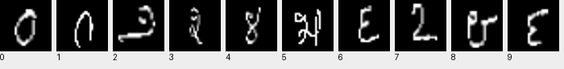

Kannada-MNIST
=================

Overview
--------

Kannada-MNIST is a grayscale image classification dataset with
10 classes and 28 x 28 images. The official split is preserved:

- **Train**: 60,000 images.
- **Test**: 10,000 images.

Data Structure
--------------

Each sample contains ``image`` (a grayscale ``PIL.Image.Image``) and
``label`` (an integer class ID).

Labels 0-9 represent the corresponding Kannada digits. The loader uses the
author's four gzip-compressed IDX files and validates their headers,
image dimensions, payload lengths, and label ranges.

The original train/test split is used. The separate Dig-MNIST dataset and
the Kaggle competition split are not included.

Usage
-----

.. code-block:: python

    from stable_datasets.images import KannadaMNIST

    ds = KannadaMNIST(split="train")
    sample = ds[0]
    print(sample["image"].size, sample["label"])

    # Load both official splits.
    splits = KannadaMNIST()
    print(len(splits["train"]), len(splits["test"]))

    # Images become float tensors of shape (1, 28, 28).
    tensor_ds = ds.with_format("torch")

Downloads are verified with SHA-256 checksums. Set ``download_dir`` and
``processed_cache_dir`` to choose local storage locations. Subsequent loads
reuse the processed cache. See the dataset source for its citation.

References
----------

- Source: https://github.com/vinayprabhu/Kannada_MNIST
- License: Creative Commons Attribution 4.0 International (CC BY 4.0).
- Dataset release and license: https://zenodo.org/records/3359691.
- Citation: Prabhu, V. U. (2019). Kannada-MNIST: A new handwritten digits
  dataset for the Kannada language. https://arxiv.org/abs/1908.01242.
